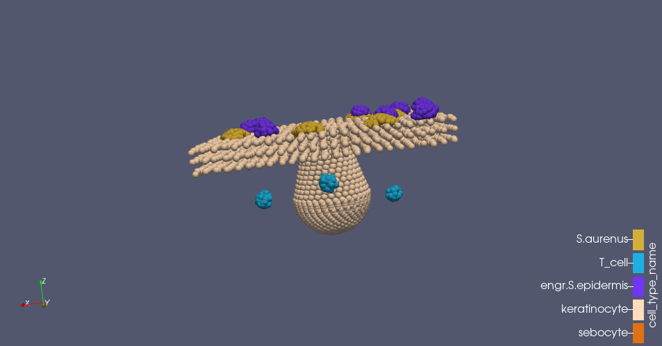
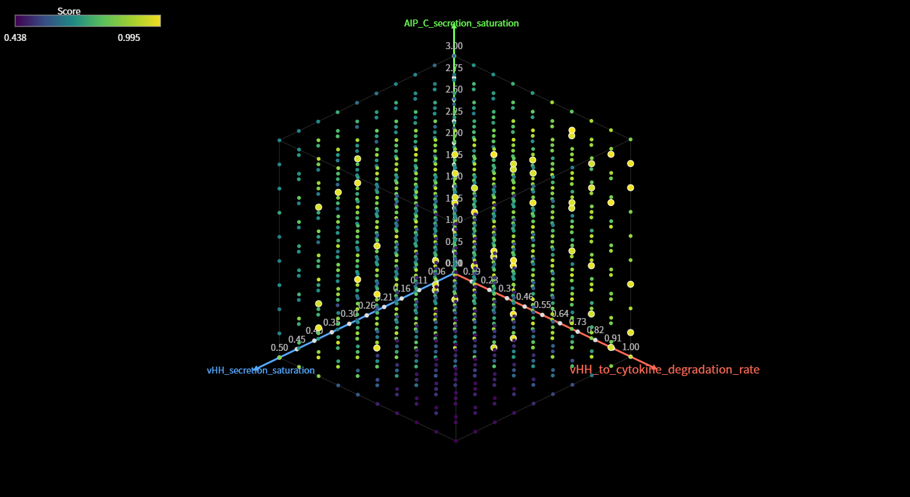
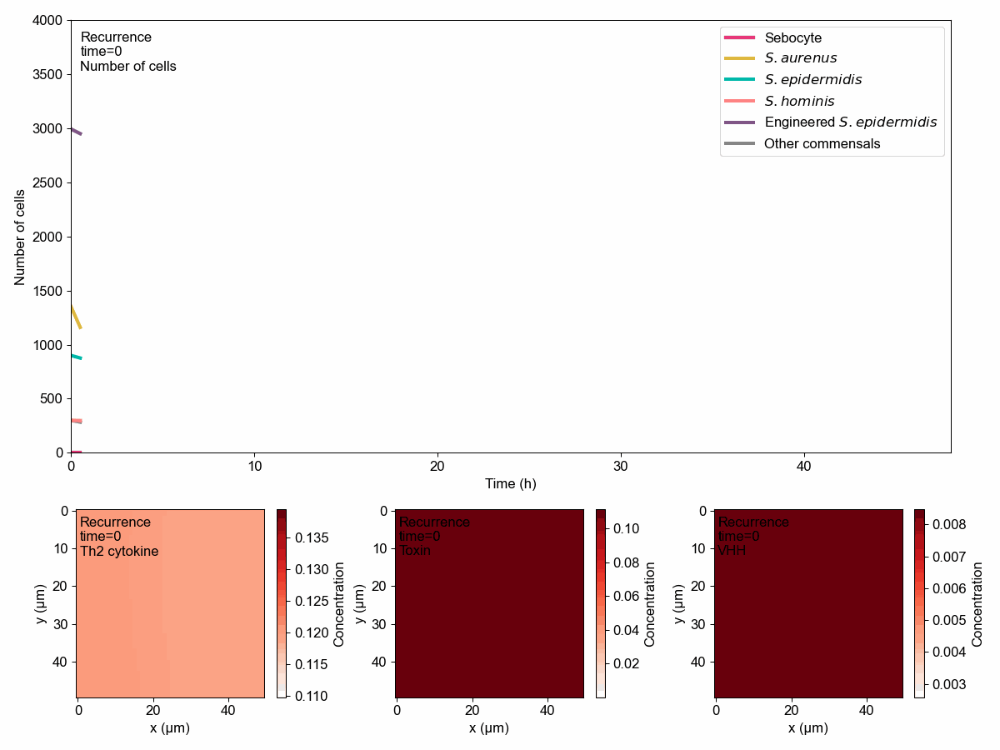

# iGEM 2025 · Multiscale Modeling of an Engineered Skin Microbiome

**Yuling Zhou · Sole modeling member, SJTU-BioX-Shanghai (2025 iGEM)**

I developed the team's modeling workflow to investigate how engineered *Staphylococcus epidermidis* could respond to *S. aureus* quorum sensing, interfere with pathogenic signaling, and modulate an inflammatory skin microenvironment. The work connects molecular circuit analysis, spatial agent-based simulations, and quantitative parameter exploration.

[Research overview](docs/RESEARCH.md) · [My contributions](docs/CONTRIBUTIONS.md) · [Run the models](docs/REPRODUCIBILITY.md) · [Original wiki drafts](docs/wiki/README.md) · [Original iGEM GitLab](https://gitlab.igem.org/linnazhou/model-tools-for-2025-sjtu-biox-shanghai) · [Published team wiki](https://2025.igem.wiki/sjtu-biox-shanghai/model)

## Research question

How can an engineered commensal balance persistent colonization with suppression of pathogenic signaling and inflammation? I approached this question at three scales:

| Scale | Approach | Question | Available material |
| --- | --- | --- | --- |
| Molecular | ODEs in MATLAB SimBiology; sensitivity analysis | Can the Agr-responsive circuit support inhibitory signaling and antibody secretion? | [Equations, parameter tables and figures](docs/wiki/model-part1.md); the SimBiology project file is not in the supplied sources |
| Community | 2D PhysiCell agents with Hill-response behavior rules | How do microbial competition, biofilm capture and engineered-strain seeding change colonization? | [Four model variants](models), C++ modules, rule tables and initial conditions |
| Tissue | 3D PhysiCell/BioFVM | How do skin geometry, tissue barriers and host cells affect local signaling? | [Occurrence](models/AD_3D) and [recurrence](models/Recurrence_3D) models, geometry generators |
| Design | 10 × 10 × 10 parameter sweep | Which combinations balance pathogen control and engineered-strain persistence? | [1,000 archived time series](models/Recurrence/sweep_outputs), [scores](results/scored_runs.csv), [analysis](scripts/analyze_sweep.py) |

These are staged models of the same design; the supplied code does not directly couple SimBiology ODEs into PhysiCell.



*Original 2025 wiki figure: layered keratinocytes, a sebaceous-gland structure, surface microbial colonies and dermal immune-cell clusters.*

## My modeling work

- Formulated the molecular circuit model and interpreted its dynamics and sensitivity analysis.
- Adapted PhysiCell's existing cell behavior grammar to microbial interactions and host–microbe feedback.
- Built 2D occurrence, recurrence and treatment scenarios, then extended occurrence and recurrence to a 3D skin geometry.
- Implemented custom substrate reactions and capture mechanisms for EPS and tissue-barrier fields.
- Developed output analysis for population dynamics, substrate fields and bivariate spatial correlation.
- Explored 1,000 combinations of VHH activity, AIP-C secretion saturation and VHH secretion saturation, with an explicit population-based scoring objective.

PhysiCell, BioFVM, the cell behavior grammar framework and MATLAB SimBiology are upstream tools. Experimental measurements and the therapeutic design belong to the wider team. See [contribution boundaries and source provenance](docs/CONTRIBUTIONS.md).

## Selected computational results



*Original project figure extracted from the supplied 2025 Word draft; corresponds to Figure 40 (parameter-scan score space) in the published team wiki.*



*Original project figure extracted from the supplied 2025 Word draft; corresponds to Figure 29 (population and substrate plots for the Recurrence model) in the published team wiki. The draft’s embedded animation format is preserved.*

The original wiki reports lower simulated toxin and cytokine fields in recurrence scenarios with the engineered strain, and localized 3D responses to nearby pathogenic colonies. These observations motivate further design work. They are computational results; full historical field-output datasets were not included in the supplied GitLab repository.

The archived sweep contains **1,000 parameter combinations, each with 25 time points over 24 simulated hours**. During portfolio preparation, every archived population score was recomputed and matched exactly. The scoring objective penalizes pathogen population increases and engineered-strain population losses; it does not directly score clinical outcomes.

The [verification appendix](docs/VERIFICATION.md) records these checks and contains clearly labeled plots newly generated from the archived CSVs in October 2026. Those plots are separate from the original 2025 figures displayed above.

## Quick start

Linux, Python 3.10+, GNU Make and a C++ compiler with OpenMP are needed. The included PhysiCell **1.14.2** source snapshot makes compilation independent of a separate Studio installation.

```bash
# Build and run a short 2D initialization/dynamics check.
python3 scripts/run_model.py Recurrence --threads 2 --max-time 1

# Run the configured recurrence simulation (48 simulated hours).
python3 scripts/run_model.py Recurrence --threads 4

# Recompute all 1,000 archived scores using only the Python standard library.
python3 models/Recurrence/score_runs.py --output results/scored_runs.csv

# Generate an offline, rotatable parameter-space visualization.
python3 models/Recurrence/scatter3d_axes_offline.py \
  --csv results/scored_runs.csv --top-percent 0.05 \
  --output results/parameter-space.html
```

Open the generated HTML locally to rotate the parameter space. To regenerate the static figures and verification report:

```bash
python3 -m venv .venv
source .venv/bin/activate
python -m pip install -r requirements.txt
python scripts/analyze_sweep.py
```

The runner creates isolated working copies under `build/`, fixes legacy file paths, selects the active Studio settings, and directs each model to its own output folder. [Reproducibility notes](docs/REPRODUCIBILITY.md) explain the difference between a short smoke run, the archived sweep and a full simulation.

## Repository guide

```text
models/                  Six original modeling projects and archived sweep data
scripts/                 Portable model runner and result verification/plotting
results/                 Recomputed scores, verification report and offline HTML
docs/                    Research narrative, contribution statement and run guide
docs/wiki/               Searchable conversions with extracted original figures
vendor/PhysiCell/         Upstream simulation engine, version 1.14.2, with licenses
```

Published source files are tracked in a [SHA-256 manifest](docs/source-manifest.json). The six original Word drafts are retained locally; this public repository includes their Markdown conversions and extracted figures. Backups, stale process files and compiled artifacts are excluded from the curated copy; their original locations remain documented. New packaging, documentation and verification scripts were added during portfolio preparation in October 2026.

## Attribution

Original project: **SJTU-BioX-Shanghai, 2025 iGEM**. Personal modeling portfolio: **Yuling Zhou**. Upstream engine citations and component licenses are listed in [THIRD_PARTY_NOTICES.md](THIRD_PARTY_NOTICES.md). No new blanket license has been assigned to the team's original materials.
