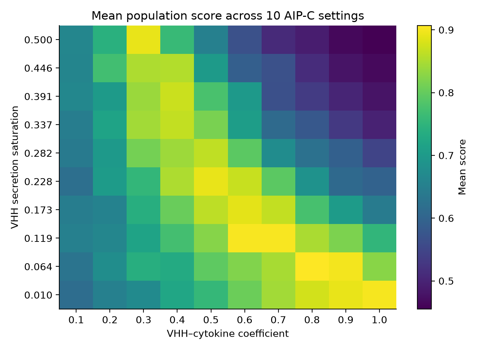

# Research overview

The project explores an engineered *Staphylococcus epidermidis* commensal that detects *S. aureus* autoinducing peptide signaling. Its response combines a competing quorum-sensing signal (AIP-C) with antibody secretion, aiming to suppress pathogenic signaling and alter an inflammatory skin microenvironment in an atopic-dermatitis project.

The modeling workflow progresses from molecular circuit behavior to community dynamics and tissue geometry. Each stage answers a different question; these models are not directly coupled in the supplied implementation.

## Molecular circuit

The SimBiology model describes the *S. aureus* Agr positive feedback loop and the engineered *S. epidermidis* response. Reactions cover transcription, translation, phosphorylation, signal production, degradation and secretion, using Hill responses to capture saturating regulation. The extracellular part uses population-scaled signal exchange; the spatial diffusion solver belongs to the later PhysiCell models.

The draft initially models scFv and motivates a move toward VHH through sensitivity analysis. It contains both molecule names in places, so the portfolio does not treat scFv simulations as a validated VHH model. The original equations, parameters, initial concentrations and sensitivity figures are available in the [molecular chapter](wiki/model-part1.md).

The supplied sources contain no `.sbproj` or MATLAB `.m` files. Molecular-model results therefore remain documented results, without an executable SimBiology artifact in this export. A conflicting scFv concentration appears in the overview and molecular drafts; the portfolio omits a quantitative secretion claim until the underlying units are checked.

## Spatial microbial communities

PhysiCell agents represent microcolonies or host-cell units. Rule tables map signals to behaviors such as secretion, death or migration using the existing cell behavior grammar. BioFVM handles diffusing fields. Custom C++ modules add substrate reactions and local capture processes.

| Source model | Portfolio interpretation | Active settings |
| --- | --- | --- |
| `AD_trial1` | Initial 2D disease-occurrence model | `config/settings` |
| `AD_trial2` | Revised 2D occurrence model with EPS/biofilm mechanisms | `config/settings.xml` |
| `Recurrence` | 2D recurrence scenario with engineered strain | `config/settings.xml` |
| `Treatment` | 2D treatment scenario with higher pathogen burden | `config/settings.xml` |
| `AD_3D` | 3D occurrence scenario | `config/PhysiCell_settings.xml` |
| `Recurrence_3D` | 3D recurrence scenario with engineered strain | `config/PhysiCell_settings.xml` |

The wiki's `Occurrence_trial1`/`Occurrence_trial2` correspond to the supplied `AD_trial1`/`AD_trial2` folders. Original identifiers, including misspellings such as `S_aurenus_count`, remain unchanged to preserve code and data compatibility.

The 2D scenarios examine colonization, competition and the toxin–cytokine–AMP feedback chain. EPS capture of AMP and bacteriocin approximates biofilm protection. This is a binding/immobilization surrogate: the custom code does not generally implement a spatially varying BioFVM diffusion coefficient.

The 3D extension introduces layered keratinocytes, superficial dermal immune-cell clusters, a sebaceous-gland geometry and surface microbial colonies. ECM fields use related capture mechanisms to approximate tissue barriers. Original model geometry is shown below.

The wiki reports spatially localized toxin and VHH responses and lower toxin/cytokine fields in engineered-strain recurrence scenarios. Those original visualizations are included in the [results draft](wiki/physicell4.md). Full raw field-output datasets and all referenced movies were not supplied, so these findings have not been independently rerun over the original time horizon.

## Parameter exploration

The archived recurrence sweep covers the following grid:

| Parameter | Range | Grid points |
| --- | --- | --- |
| `vHH_to_cytokine_degradation_rate` | 0.1–1.0 | 10 |
| AIP-induced AIP-C secretion saturation | 0.5–3.0 | 10 |
| AIP-induced VHH secretion saturation | 0.01–0.5 | 10 |

The original scorer defines six directional penalties: mean and endpoint *S. aureus* increases, mean and endpoint engineered-strain losses, and undesired step-to-step changes in each population. Mean/endpoint terms have weight 1, and step penalties have weight 0.5. It maps the weighted penalty $P$ to:

$$\mathrm{Score}=\frac{1}{1+P}.$$

A high score means the two populations satisfy the chosen objective over the archived horizon. It does not measure inflammation directly, establish an experimentally validated optimum, or test long-term safety. The archived population series span 24 hours, while the active recurrence settings specify 48 hours; those horizons must not be conflated.

*New verification plot generated during portfolio preparation in October 2026; this is not an original 2025 wiki figure. Each cell averages the ten AIP-C settings at a fixed VHH parameter pair. All 100 cells were independently checked against the archived trajectories; see the [numerical grid](../results/mean-score-grid.csv) and [verification method](VERIFICATION.md#independent-heatmap-verification--15-october-2026). The 2025 original parameter-space figures are preserved in the [results manuscript](wiki/physicell4.md).*

The highest-scoring archived combination is run 791: coefficient **0.8**, AIP-C saturation **3.0**, and VHH saturation **0.0644444**, with score **0.994872**. Its pathogen count changes from **1,350 to 1,308** and engineered-strain count from **3,000 to 3,076** over 24 hours. All 1,000 stored scores match recomputation exactly. The source supplies one trajectory for each parameter combination; biological robustness and stochastic uncertainty require additional validation.

## Research skills demonstrated

This work combines mechanistic model formulation, translation of biological hypotheses into agent rules, C++ extension of an existing simulation engine, spatial data analysis, computational experiment design and interpretation of competing design objectives. It also illustrates how in-silico results can identify questions for subsequent experiments without substituting for those experiments.
