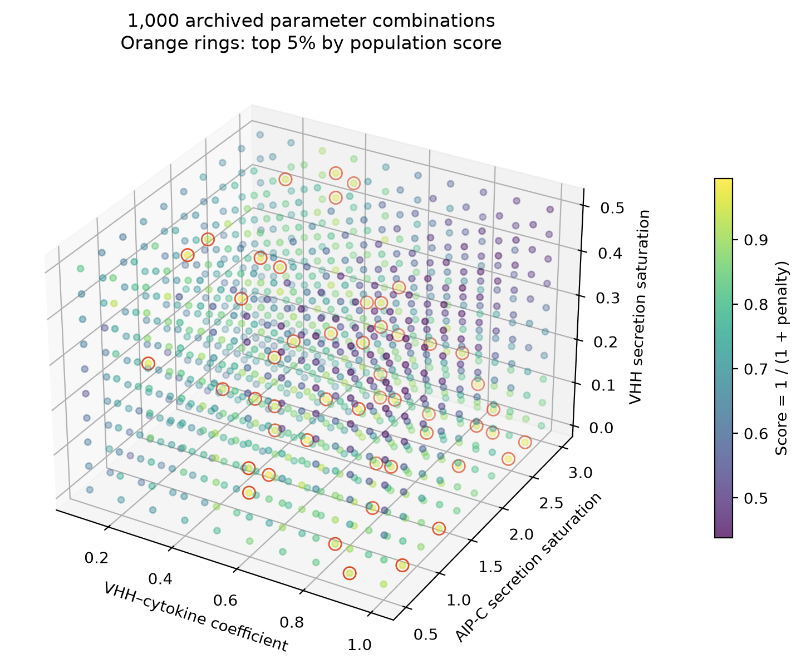
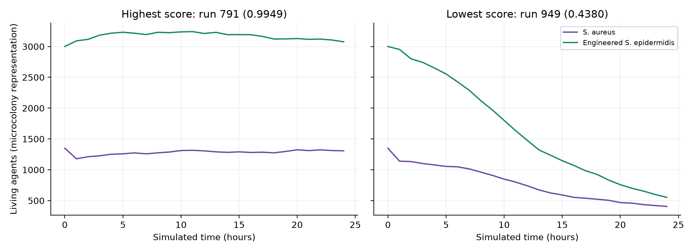

# Verification appendix — October 2026

This appendix documents work added during portfolio preparation. The following plots were newly generated from the archived 2025 CSV files in October 2026. They are not original 2025 wiki figures and do not represent new simulation experiments.

The [original 2025 results figures](wiki/physicell4.md) remain the visual record of the iGEM project.

## Archived-data consistency

All 1,000 archived runs were rescored using the original scoring function. Each contains 25 observations from 0 to 1,440 minutes. All six penalty components and final scores agree exactly with the archived score table. This is a data consistency check, not independent biological validation.

*2026 redraw: orange rings mark the 50 highest-scoring grid points.*

*2026 comparison: the highest- and lowest-scoring archived trajectories, selected by the original population objective. These particular comparative panels were not present in the original wiki.*

*2026 summary: mean score across the ten AIP-C settings for each VHH parameter pair.*

## Execution checks

Six PhysiCell models compiled and completed one-minute runs using portable settings. This establishes configuration loading and early software execution, not full-horizon reproduction of the research findings.

Evidence: [model smoke checks](../results/model-smoke-checks.json) and [sweep consistency report](../results/sweep-verification.json). Regenerate this appendix’s plots with `python scripts/analyze_sweep.py` after installing `requirements.txt`.
