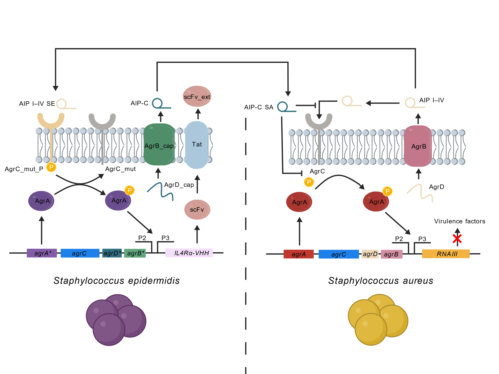
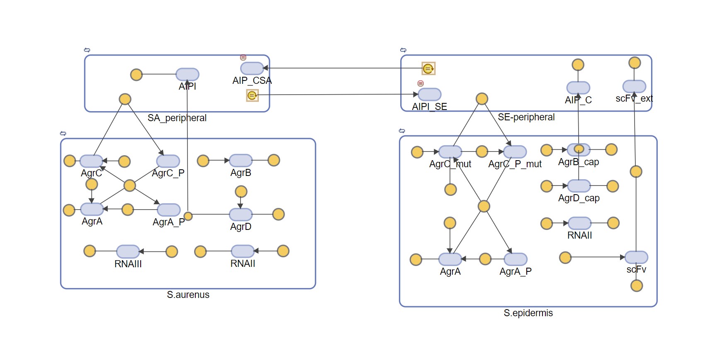
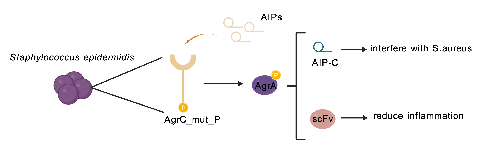
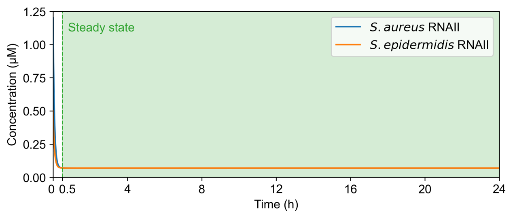
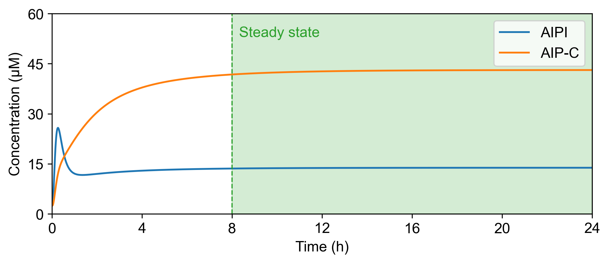
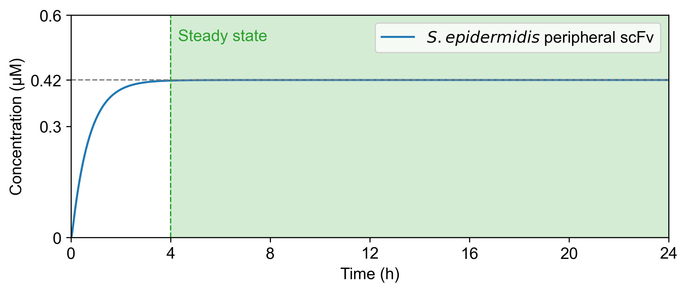
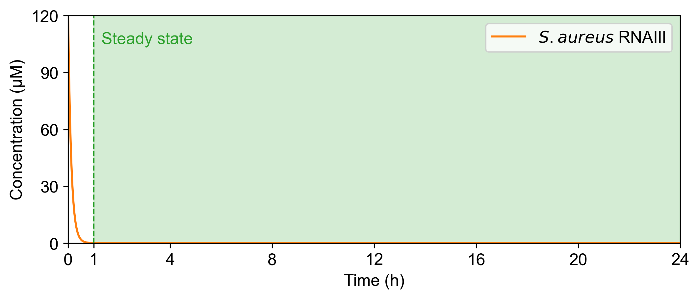
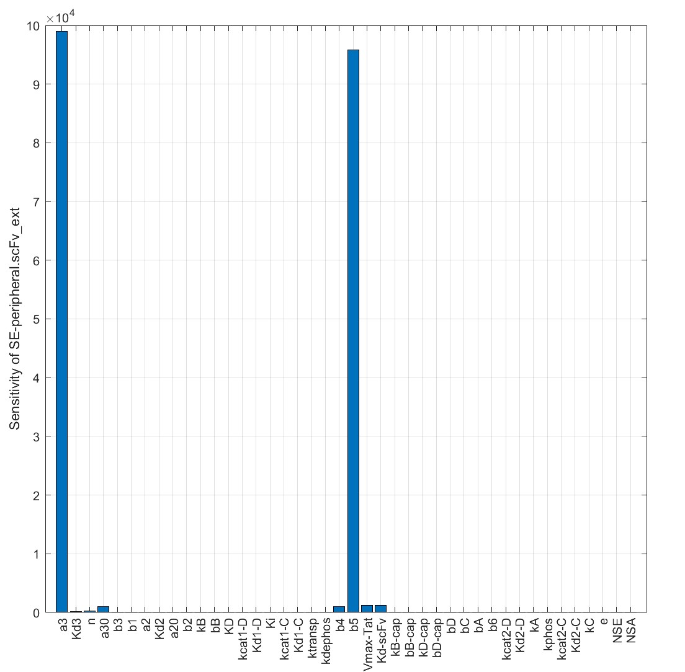
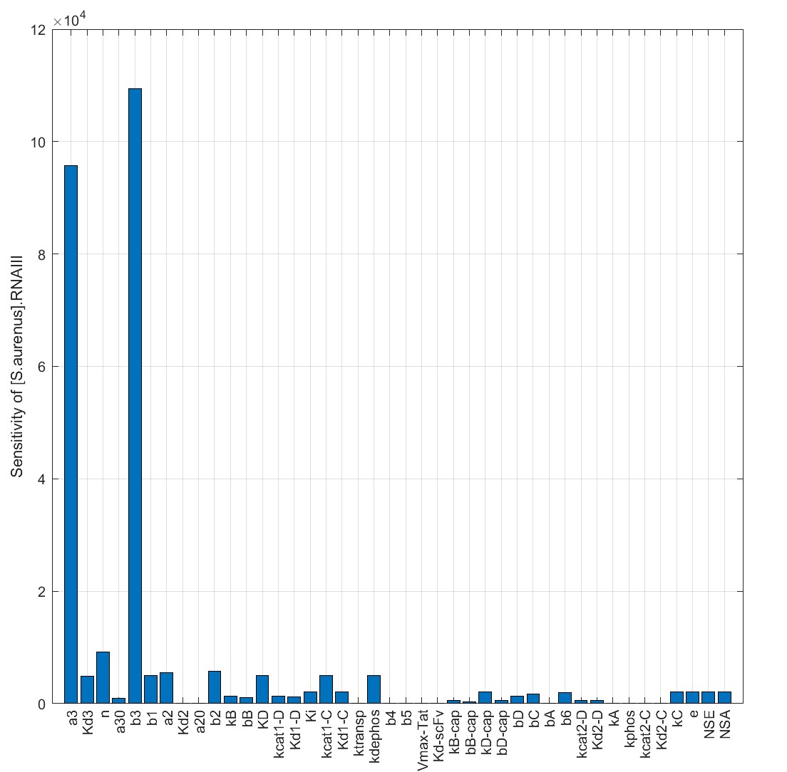

# MODEL Part1 — wiki manuscript

> Converted from the locally retained source document `MODEL Part1.docx`. Edited for portfolio readability: internal layout notes and conversion artifacts have been removed. The [published team wiki](https://2025.igem.wiki/sjtu-biox-shanghai/model) presents the final results; see [editorial notes](../EDITORIAL_NOTES.md) before interpreting its claims.

# Molecular-Level Validation with Gene Circuit Simulation

## Model Highlight

**Simulation of the gene circuit confirmed the stability and therapeutic effect of the experimental design.**

**ScFv final concentration can reach about 0.42mM, which is much higher than the therapeutic concentration.**

**Sensitivity analysis suggests replacing scFv with VHH molecules, providing guidance for subsequent wet-lab experiments.**

## Model Description

To examine the feasibility of our design at the molecular scale, we constructed a set of ordinary differential equations (ODEs) describing the dynamics of quorum sensing and regulatory circuits in *Staphylococcus aureus* (*S.aureus*) and *Staphylococcus epidermidis* (*S.epidermidis*). The purpose of this model is to **validate whether the proposed gene circuit stimulation can generate the desired molecular interactions in a controlled environment**.

Our framework is organized into **three interconnected modules** that together capture the full pathway from intracellular signaling to inter-species molecular crosstalk:

1.  ***S. aureus* dynamics** – intracellular reactions in *S. aureus* and molecular interactions between intracellular and extracellular compartments of *S. aureus* . Describing the cascaded amplification of the quorum sensing Agr system and downstream virulence factors expression, the secretion of autoinducing peptides (AIPs) and sensing the inhibition signal from *S. epidermidis*.

2.  ***S. epidermidis* dynamics** – intracellular reactions in *S. epidermidis* and molecular exchange between extracellular and intracellular compartments. Describing the AIP binding modulated downstream gene regulation, which contributes to the expression of therapeutic molecule VHH and inhibition molecule AIP-C, as well as the interaction between AIPs secreted by *S. aureus and* receptors on *S. epidermidis* and the secretion of downstream therapeutic molecule scFv.

3.  **Extracellular environment** – stimulate the diffusion of AIPs and AIP-C, as well as the therapeutic molecule VHH.



Molecules Interaction Diagram

For the first part of our modeling, we employed **MATLAB SimBiology**, a specialized toolbox for constructing, simulating, and analyzing biological systems. SimBiology allows us to represent our experimental design as a set of biochemical reactions and differential equations, providing a framework to explore system dynamics in a reproducible way. By abstracting our gene circuit into interactions between molecular species, we can test the feasibility of our design in silico before proceeding to experiments.



Simbiology representation derived from the molecular interaction diagram

The resulting system captures dynamics of molecular species and enables simulations of signal accumulation, interspecies interference, and regulatory outcomes. By analyzing steady states, time courses, and parameter sensitivities, we evaluate whether the engineered gene circuit stimulation can suppress pathogenic quorum sensing while promoting commensal resilience under realistic conditions.

## Model Assumptions

Through a review of the literature (Moormeier et al., 2017), our model assumes that *S. aureus* and *S. epidermidis* **exist in the form of microcolonies**. Therefore, in our framework each microcolony is treated as a single “cell-like” unit, and molecular interactions are established between the *S. aureus* and *S. epidermidis* microcolonies **as wholes**.

For ligand–receptor binding, we adopted the **Hill equation** to describe the process. The Hill function is widely used in biological modeling because it captures both cooperative binding effects and the saturable nature of receptor–ligand interactions. This enables the model to approximate nonlinear signal amplification and threshold-like responses observed in quorum sensing and gene regulation systems.

Finally, for the extracellular environment, we assume that the diffusion of signaling and therapeutic molecules is homogeneous. In addition, the spatial distribution of bacterial microcolonies is considered relatively uniform, and proteins secreted by both species are assumed to follow the same diffusion and degradation dynamics. These simplifications reduce spatial complexity and allow us to focus on the temporal evolution of molecular concentrations that mediate the interactions between the two bacterial species.

## *S. aureus* Dynamics


*S.aureus* Dynamics Diagram

The following reactions and ordinary differential equations (ODEs) describe the molecular circuitry of *S. aureus* (the Agr quorum-sensing system and its effectors).

The regulatory circuit is modeled as a positive feedback loop. Specifically, transcription of the agr operon (represented here by RNAII) produces the Agr proteins (AgrB, AgrD, AgrC, AgrA). AgrD is processed by AgrB into the autoinducing peptide (AIP). AIP activates AgrC, which autophosphorylates and transfers the phosphate to AgrA; phosphorylated AgrA (AgrA_P) enhances transcription of the agr operon (RNAII) and RNAIII, thereby closing the feedback loop. RNAIII functions as the effector of this circuit and directs the expression of virulence factors.

In addition, we include AIP_C, a competing signal secreted by *S. epidermidis*, which binds to AgrC and competitively inhibits its activation, thereby blocking the signalling cascade. All molecular species are modeled with both synthesis and degradation terms, allowing the system to approach a dynamic steady state while still exhibiting transient behaviors that underlie interspecies signalling. This molecular-level description establishes the mechanistic basis for subsequent population- and spatial-scale modeling.

**Reaction formula**

```math
\begin{array}{r}
RNAIII{\overset{b_{3}}{\rightarrow}\varnothing}
\end{array}
```

```math
SA.RNAII\overset{b_{2}}{\rightarrow}\varnothing
```

```math
AgrB\overset{b_{B}}{\rightarrow}\varnothing
```

```math
AgrD\overset{AgrB}{\rightarrow}AIP
```

```math
AgrC + AIP\overset{k_{cat_{1C}}}{\rightarrow}AgrC_{P} \bullet AIP
```

```math
AgrC + AIP_{C}\overset{Ki}{\rightarrow}AgrC \bullet AIP_{C}
```

```math
AIP\overset{b_{1}}{\rightarrow}\varnothing
```

```math
AgrC_{P} + SA.AgrA\overset{k_{transp}}{\rightarrow}AgrC + SA.AgrA_{P}
```

```math
SA.AgrA_{P}\overset{k_{dephos}}{\rightarrow}SA.AgrA
```

**Ordinary Differential Equations**

```math
\frac{d\lbrack RNAIII\rbrack}{dt} = \frac{a_{3}}{{(\frac{{Kd}_{3}}{SA.AgrA_{P}})}^{n} + 1} + a_{30} - b_{3} \bullet \lbrack RNAIII\rbrack
```

```math
\frac{d\lbrack SA.RNAII\rbrack}{dt} = \frac{a_{2}}{{(\frac{{Kd}_{2}}{SA.AgrA_{P}})}^{n} + 1} + a_{20} - b_{2} \bullet \lbrack SA.RNAII\rbrack
```

```math
\frac{d\lbrack AgrB\rbrack}{dt} = k_{B} \bullet \lbrack SA.RNAII\rbrack - b_{B} \bullet \lbrack AgrB\rbrack
```

```math
\frac{d\lbrack AgrD\rbrack}{dt} = k_{D} \bullet \lbrack SA.RNAII\rbrack - \frac{k_{cat_{1D}} \bullet \lbrack AgrB\rbrack \bullet \lbrack AgrD\rbrack}{{Kd}_{1D} + \lbrack AgrD\rbrack} - b_{D} \bullet \lbrack AgrD\rbrack
```

```math
\frac{d\lbrack AgrC\rbrack}{dt} = - \frac{k_{cat_{1C}} \bullet \lbrack AIP\rbrack \bullet \lbrack AgrC\rbrack}{{Kd}_{1C} \bullet \left( 1 + \frac{\lbrack AIP_{C_{SA}}\rbrack}{Ki} \right) + \lbrack AgrC\rbrack} + k_{transp} \bullet \left\lbrack AgrC_{P} \right\rbrack \bullet \lbrack SA.AgrA\rbrack - b_{C} \bullet \lbrack AgrC\rbrack + k_{C} \bullet \lbrack SA.RNAII\rbrack
```

```math
\frac{d\lbrack SA.AgrA\rbrack}{dt} = - k_{transp} \bullet \left\lbrack AgrC_{P} \right\rbrack \bullet \lbrack SA.AgrA\rbrack + k_{dephos} \bullet \left\lbrack SA.AgrA_{P} \right\rbrack - b_{A} \bullet \lbrack SA.AgrA\rbrack + k_{A} \bullet \lbrack SA.RNAII\rbrack
```

```math
\frac{d\lbrack SA.AgrA_{P}\rbrack}{dt} = k_{transp} \bullet \left\lbrack AgrC_{P} \right\rbrack \bullet \lbrack SA.AgrA\rbrack - k_{dephos} \bullet \lbrack SA.AgrA_{P}\rbrack
```

```math
\frac{d\lbrack AgrC_{P}\rbrack}{dt} = \frac{k_{cat_{1C}} \bullet \lbrack AIP\rbrack \bullet \lbrack AgrC\rbrack}{{Kd}_{1C} \bullet \left( 1 + \frac{\left\lbrack AIP_{C_{SA}} \right\rbrack}{Ki} \right) + \lbrack AgrC\rbrack} - k_{transp} \bullet \left\lbrack AgrC_{P} \right\rbrack \bullet \lbrack SA.AgrA\rbrack
```

```math
\frac{d\lbrack AIP\rbrack}{dt} = \frac{k_{cat_{1D}} \bullet \lbrack AgrB\rbrack \bullet \lbrack AgrD\rbrack}{{Kd}_{1D} + \lbrack AgrD\rbrack} - b_{1} \bullet \lbrack AIP\rbrack
```

## *S. epidermidis* Dynamics



Figure 4 *S. epidermidis* Dynamics Diagram

The following reactions and ordinary differential equations (ODEs) describe the engineered regulatory circuit of *S. epidermidis*.

In *S. epidermidis*, a synthetic circuit based on a modified Agr system regulates both interspecies signaling and therapeutic protein production. Transcription of SE.RNAII drives the expression of AgrB_cap, AgrD_cap, AgrC_mut, and AgrA. Among them, AgrD_cap is processed by AgrB_cap into AIP<sub>C</sub>, which is secreted into the extracellular environment and functions as an inhibitory signal against the AgrC receptor of *S. aureus* .

The engineered receptor AgrC_mut can be activated by binding to AIP molecules secreted by *S. aureus* or via self-phosphorylation. Once activated, AgrC_mut<sub>P</sub> phosphorylates SE.AgrA, converting it into SE.AgrA<sub>P</sub>. Phosphorylated AgrA then acts as a transcriptional activator, enhancing the transcription of SE.RNAII and reinforcing a positive feedback loop. It also promotes the expression of the therapeutic molecule scFv, which is first produced intracellularly and subsequently secreted into the extracellular space (scFv_ext) through the Tat secretion pathway.

All molecules—including RNAII, Agr proteins, AIP<sub>C</sub>, and scFv—are modeled with both synthesis and degradation terms, ensuring that the system can achieve a dynamic steady state while remaining sensitive to interspecies signaling dynamics.

**Reaction formula**

```math
scFv\overset{b_{4}}{\rightarrow}\varnothing
```

```math
scFv\overset{Tat}{\rightarrow}scFv\_ ext
```

```math
scFv\_ ext\overset{b_{5}}{\rightarrow}\varnothing
```

```math
SE.RNAII\overset{b_{2}}{\rightarrow}\varnothing
```

```math
AgrB\_ cap\overset{b_{B_{cap}}}{\rightarrow}\varnothing
```

```math
AgrD\_ cap\overset{b_{D_{cap}}}{\rightarrow}\varnothing
```

```math
AgrD\overset{b_{D}}{\rightarrow}\varnothing
```

```math
AgrC\overset{b_{C}}{\rightarrow}\varnothing
```

```math
SA.AgrA\overset{b_{A}}{\rightarrow}\varnothing
```

```math
AgrD\_ cap\overset{AgrB\_ cap}{\rightarrow}{AIP}_{C}
```

```math
{AIP}_{C}\overset{b_{6}}{\rightarrow}\varnothing
```

```math
AgrC\_ mut + AIP\overset{k_{cat_{2C}}}{\rightarrow}{AgrC\_ mut}_{P} \bullet AIP
```

```math
AgrC\_ mut\overset{k_{phos}}{\rightarrow}{AgrC\_ mut}_{P}
```

```math
{AgrC\_ mut}_{P} + SE.AgrA\overset{k_{transp}}{\rightarrow}AgrC\_ mut + SE.AgrA_{P}
```

```math
SE.AgrA_{P}\overset{k_{dephos}}{\rightarrow}SE.AgrA
```

```math
SE.AgrA\overset{b_{A}}{\rightarrow}\varnothing
```

```math
AgrC\_ mut\overset{b_{C}}{\rightarrow}\varnothing
```

**Ordinary Differential Equations**

```math
\frac{d\lbrack SE.RNAII\rbrack}{dt} = \frac{a_{2}}{{(\frac{{Kd}_{2}}{SA.AgrA_{P}})}^{n} + 1} + a_{20} - b_{2} \bullet \lbrack SE.RNAII\rbrack
```

```math
\frac{d\lbrack AgrB\_ cap\rbrack}{dt} = k_{B\_ cap} \bullet \lbrack SE.RNAII\rbrack - b_{B_{cap}} \bullet \lbrack AgrB\_ cap\rbrack
```

```math
\frac{d\lbrack AgrD\_ cap\rbrack}{dt} = k_{D\_ cap} \bullet \lbrack SE.RNAII\rbrack - \frac{k_{cat_{2D}} \bullet \lbrack AgrB\_ cap\rbrack \bullet \lbrack AgrD\_ cap\rbrack}{{Kd}_{2D} + \lbrack AgrD\_ cap\rbrack} - b_{D_{cap}} \bullet \lbrack AgrD\_ cap\rbrack
```

```math
\frac{d\lbrack AgrC\_ mut\rbrack}{dt} = - \frac{k_{cat_{2C}} \bullet \left\lbrack AIP_{SE} \right\rbrack \bullet \lbrack AgrC\_ mut\rbrack}{{Kd}_{2C} + \lbrack AgrC\_ mut\rbrack} - k_{phos} \bullet \lbrack AgrC\_ mut\rbrack + k_{transp} \bullet \left\lbrack {AgrC\_ mut}_{P} \right\rbrack \bullet \lbrack SE.AgrA\rbrack - b_{C} \bullet \lbrack AgrC\_ mut\rbrack + k_{C} \bullet \lbrack SE.RNAII\rbrack
```

```math
\frac{d\left\lbrack {AgrC\_ mut}_{P} \right\rbrack}{dt} = \frac{k_{cat_{2C}} \bullet \left\lbrack AIP_{SE} \right\rbrack \bullet \lbrack AgrC\_ mut\rbrack}{{Kd}_{2C} + \lbrack AgrC\_ mut\rbrack} + k_{phos} \bullet \left\lbrack AgrC_{mut} \right\rbrack - k_{transp} \bullet \left\lbrack {AgrC_{mut}}_{P} \right\rbrack \bullet \lbrack SE.AgrA\rbrack
```

```math
\frac{d\lbrack SE.AgrA\rbrack}{dt} = - k_{transp} \bullet \left\lbrack Agr{C\_ mut}_{P} \right\rbrack \bullet \lbrack SE.AgrA\rbrack + k_{dephos} \bullet \left\lbrack SE.AgrA_{P} \right\rbrack - b_{A} \bullet \lbrack SE.AgrA\rbrack + k_{A} \bullet \lbrack SE.RNAII\rbrack
```

```math
\frac{d\lbrack SE.AgrA_{P}\rbrack}{dt} = k_{transp} \bullet \left\lbrack Agr{C\_ mut}_{P} \right\rbrack \bullet \lbrack SE.AgrA\rbrack - k_{dephos} \bullet \lbrack SE.AgrA_{P}
```

```math
\frac{d\lbrack scFv\rbrack}{dt} = \frac{a_{3}}{{(\frac{{Kd}_{3}}{\lbrack SE.AgrA_{P}\rbrack})}^{n} + 1} + a_{30} - b_{4} \bullet \lbrack scFv\rbrack - \frac{Tat_{V_{\max}} \bullet \lbrack scFv\rbrack}{{Kd}_{scFv} + \lbrack scFv\rbrack}
```

```math
\frac{d\lbrack AIP_{C}\rbrack}{dt} = \frac{k_{cat_{2D}} \bullet \lbrack AgrB\_ cap\rbrack \bullet \lbrack AgrD\_ cap\rbrack}{{Kd}_{2D} + \lbrack AgrD\_ cap\rbrack} - b_{6} \bullet \lbrack AIP_{C}\rbrack
```

**Extracellular environment**

To capture the interactions between *Staphylococcus aureus* and *Staphylococcus epidermidis* at the colony level, we implemented a signal conversion approach. This method normalizes the effective concentration of signaling molecules based on the relative abundance of each species, ensuring that the contribution of each population is balanced. In this way, the signals perceived by *S. epidermidis* from *S. aureus* and vice versa are adjusted according to the number of colonies of each species, with an additional scaling factor, allowing the model to more realistically reflect interspecies communication at the population level.

**Equations**

```math
\left\lbrack AIP_{SE} \right\rbrack = e \bullet \frac{N_{SA}}{N_{SE}} \bullet \lbrack AIP\rbrack
```

```math
\left\lbrack AIP_{C_{SA}} \right\rbrack = e \bullet \frac{N_{SE}}{N_{SA}} \bullet \lbrack AIP_{C}\rbrack
```

| **Parameters** | **Description** | **Unit** | **Value** | **Reference** |
|:--:|----|:--:|---:|:--:|
| $a_{3}$ | The maximum transcription rate of P3 when promoter leakage is not considered | μM/s | 0.00017 | Assumption |
| ${Kd}_{3}$ | AgrA_P concentration at which the translation rate of P3 is half its maximum value | μM | 1 | Rajasree, K., Fasim, A., & Gopal, B. (2016). Conformational features of the *Staphylococcus aureus* AgrA-promoter interactions rationalize quorum-sensing triggered gene expression. Biochemistry and biophysics reports, 6, 124–134. https://doi.org/10.1016/j.bbrep.2016.03.012 |
| $n$ | Hill coefficient |  | 2 | Assumption |
| $a_{30}$ | Leaky transcription rate for P3 | μM/s | 0.0000017 | Assumption |
| $b_{3}$ | Degradation rate constant for RNAIII | /s | 0.0023 | Geisinger, E., Adhikari, R.P., Jin, R., Ross, H.F. and Novick, R.P. (2006), Inhibition of rot translation by RNAIII, a key feature of agr function. Molecular Microbiology, 61: 1038-1048. https://doi.org/10.1111/j.1365-2958.2006.05292.x |
| $b_{1}$ | Degradation rate constant for AIP | /s | 0.0012 | Assumption |
| $a_{2}$ | The maximum transcription rate of P2 when promoter leakage is not considered | μM/s | 0.00033 | Assumption |
| ${Kd}_{2}$ | AgrA_P concentration at which the translation rate of P2 is half its maximum value | μM | 0.5 | Koenig, R. L., Ray, J. L., Maleki, S. J., Smeltzer, M. S., & Hurlburt, B. K. (2004). *Staphylococcus aureus* AgrA binding to the RNAIII-agr regulatory region. Journal of bacteriology, 186(22), 7549–7555. <https://doi.org/10.1128/JB.186.22.7549-7555.2004> |
| $a_{20}$ | Leaky transcription rate for P2 | μM/s | 0.0000033 | Assumption |
| $b_{2}$ | Degradation rate constant for RNAII | /s | 0.0039 | Assumption |
| $k_{B}$ | Translation rate constant for AgrB | /s | 0.079 | Assumption |
| $b_{B}$ | Degradation rate constant for AgrB | /s | 0.000085 | Assumption |
| $k_{D}$ | Translation rate constant for AgrD | /s | 0.33 | Assumption |
| $b_{D}$ | Degradation rate constant for AgrD | /s | 0.0023 | Assumption |
| $k_{C}$ | Translation rate constant for AgrC | /s | 0.035 | Assumption |
| $b_{C}$ | Degradation rate constant for AgrC | /s | 0.00008 | Assumption |
| $k_{A}$ | Translation rate constant for AgrA | /s | 0.063 | Assumption |
| $b_{A}$ | Degradation rate constant for AgrA | /s | 0.0004 | Assumption |
| $k_{cat_{1D}}$ | Maximum rate of AgrB‑catalyzed processing of AgrD into AIP | /s | 0.01 | Assumption |
| ${Kd}_{1D}$ | AgrD concentration at which the AgrB reaction rate is half its maximum value | μM | 100 | Assumption |
| $Ki$ | The concentration of AIP‑C at which it half‑maximally competes with AIP for AgrC binding | μM | 0.2 | Canovas, J., Baldry, M., Bojer, M. S., Andersen, P. S., Gless, B. H., Grzeskowiak, P. K., Stegger, M., Damborg, P., Olsen, C. A., & Ingmer, H. (2016). Cross-Talk between *Staphylococcus aureus* and Other Staphylococcal Species via the agr Quorum Sensing System. Frontiers in Microbiology, 7, Article 1733. https://doi.org/10.3389/fmicb.2016.01733 |
| $k_{cat_{1C}}$ | Maximum rate of AIPI‑induced processing of AgrC into AgrC_P | /s | 0.0018 | Assumption |
| ${Kd}_{1C}$ | AgrC concentration at which the AIPI-induced reaction rate is half its maximum value | μM | 0.3 | Cisar, E. A. G., Geisinger, E., Muir, T. W., & Novick, R. P. (2009). Symmetric signalling within asymmetric dimers of the *Staphylococcus aureus* receptor histidine kinase AgrC. Molecular Microbiology, 74(1), 44-57. https://doi.org/10.1111/j.1365-2958.2009.06849.x |
| $k_{transp}$ | AgrC to AgrA phosphotransfer rate constant | /(s\*μM) | 0.5 | Cisar, E. A. G., Geisinger, E., Muir, T. W., & Novick, R. P. (2009). Symmetric signalling within asymmetric dimers of the *Staphylococcus aureus* receptor histidine kinase AgrC. Molecular Microbiology, 74(1), 44–57. https://doi.org/10.1111/j.1365-2958.2009.06849.x |
| $k_{dephos}$ | Dephosphorylation rate constant of AgrA | /s | 0.003 | Wang, B. (2016). Regulation of virulence in *Staphylococcus aureus*. Chemistry & Biology, 23(3), 321–330. https://doi.org/10.1016/j.chembiol.2016.01.004 |
| $b_{4}$ | Degradation rate constant for scFv | /s | 0.0002 | Assumption |
| $b_{5}$ | Degradation rate constant for scFv_ext | /s | 0.0004 | Assumption |
| $Tat_{V_{\max}}$ | Maximum rate of Tat‐dependent scFv secretion | μM/s | 0.1 | Goosens, V. J., Monteferrante, C. G., & van Dijl, J. M. (2014). The Tat system of Gram-positive bacteria. Biochimica et Biophysica Acta (BBA) – Molecular Cell Research, 1843(8), 1698–1706. https://doi.org/10.1016/j.bbamcr.2013.10.008 |
| ${Kd}_{scFv}$ | scFv concentration at which the Tat-dependent secretion rate is half its maximum value | μM/s | 5 | Assumption |
| $k_{B\_ cap}$ | Translation rate constant for AgrB_cap | /s | 0.08 | Assumption |
| $b_{B_{cap}}$ | Degradation rate constant for AgrB_cap | /s | 0.000078 | Assumption |
| $k_{D\_ cap}$ | Translation rate constant for AgrD_cap | /s | 0.33 | Assumption |
| $b_{D_{cap}}$ | Degradation rate constant for AgrD_cap | /s | 0.0023 | Assumption |
| $b_{6}$ | Degradation rate constant for AIP_C | /s | 0.0004 | Assumption |
| $k_{cat_{2D}}$ | Maximum rate of AgrB_cap‑catalyzed processing of AgrD_cap into AIP_C | /s | 0.01 | Assumption |
| ${Kd}_{2D}$ | AgrD_cap concentration at which the AgrB_cap reaction rate is half its maximum value | μM | 100 | Assumption |
| $k_{phos}$ | The self-phosphorylation rate constant of AgrC_mut | /s | 0.15 | Assumption |
| $k_{cat_{2C}}$ | Maximum rate of AIPI‑induced processing of AgrC_mut into AgrC\_ mut_P | /s | 0.05 | Assumption |
| ${Kd}_{2C}$ | AgrC_mut concentration at which the AIPI-induced reaction rate is half its maximum value | μM | 0.1 | Assumption |
| $e$ | Attenuation coefficient |  | 0.3 | Assumption |
| $N_{SE}$ | Number of S. epidermidis cells |  | 1000 | Assumption |
| $N_{SA}$ | Number of S. aurenus cells |  | 1000 | Assumption |

Table 1 Parameter Mentioned in ODEs

**Model Validation: Dynamics and Parameter Sensitivity**

**Initial settings**

| **Species** | **Value** | **Unit** | **Reference** |
|----|----|----|----|
| SA volume | 0.7 | fL | Monteiro, J. M., Fernandes, P. B., Vaz, F., Pereira, A. R., Ferreira, M. T., Sobral, R. G., … & Filipe, S. R. (2015). Cell shape dynamics during the staphylococcal cell cycle. *mBio, 6*(3), e00599-15. https://doi.org/10.1128/mBio.00599-15 |
| AgrA | 0.5 | μM | Kim, S. Y., Lee, J. H., Park, J. H., Seo, K. S., Lee, J., & Lee, J. C. (2023). Regulation of σB-Dependent Biofilm Formation in *Staphylococcus aureus*. *Microbiology Spectrum*, *11*(2), e0448322. https://doi.org/10.1128/spectrum.04483-22 |
| AgrC | 0.15 | μM | Kim, S. Y., Lee, J. H., Park, J. H., Seo, K. S., Lee, J., & Lee, J. C. (2023). Regulation of σB-Dependent Biofilm Formation in *Staphylococcus aureus*. *Microbiology Spectrum*, *11*(2), e0448322. https://doi.org/10.1128/spectrum.04483-22 |
| AgrA<sub>P</sub> | 1.9 | μM | Wang, B. (2017). Functional plasticity of the AgrC receptor histidine kinase. *Current Research in Microbial Sciences, 5*, 37-45. https://doi.org/10.1016/j.crmicr.2017.02.001 |
| AgrC<sub>P</sub> | 0.35 | μM | Srivastava, S. K., Rajasree, K., Fasim, A., Arakere, G., & Gopal, B. (2014). Influence of the AgrC-AgrA complex on the response time of *Staphylococcus aureus* quorum sensing. *Journal of Bacteriology, 196*(15), 2876–2888. https://doi.org/10.1128/JB.01530-14 |
| RNAII | 1.2 | μM | Srivastava, S. K., Rajasree, K., Fasim, A., Arakere, G., & Gopal, B. (2014). Influence of the AgrC-AgrA complex on the response time of *Staphylococcus aureus* quorum sensing. *Journal of Bacteriology, 196*(15), 2876–2888. https://doi.org/10.1128/JB.01530-14 |
| RNAIII | 120 | μM | Wang, B. (2016). Regulation of virulence in *Staphylococcus aureus*. *Chemistry & Biology*, 23(3), 321–330. https://doi.org/10.1016/j.chembiol.2016.01.004 |
| AgrB | 1.4 | μM | Tan, L., Li, S. R., Jiang, B., Hu, X. M., & Li, S. (2018). Therapeutic targeting of the *Staphylococcus aureus* accessory gene regulator (agr) system. *Frontiers in Microbiology, 9*, Article 55. https://doi.org/10.3389/fmicb.2018.00055 |
| AgrD | 2.4 | μM | Tan, L., Li, S. R., Jiang, B., Hu, X. M., & Li, S. (2018). Therapeutic targeting of the *Staphylococcus aureus* accessory gene regulator (agr) system. *Frontiers in Microbiology, 9*, Article 55. https://doi.org/10.3389/fmicb.2018.00055 |
| AIP | 2.5 | μM | Assumption |
|  |  |  |  |
| SE volume | 0.7 | fL | ScienceDirect Topics. (n.d.). *Staphylococcus epidermidis – an overview*. Elsevier. Retrieved 2025.10.5, from [https://www.sciencedirect.com/topics/medicine-and-dentistry/staphylococcus-epidermidis](https://www.sciencedirect.com/topics/medicine-and-dentistry/staphylococcus-epidermidis?utm_source=chatgpt.com) |
| scFv | 0 | μM | Assumption |
| RNAII | 1.2 | μM | Assumption |
| AgrA | 1.4 | μM | Assumption |
| AgrC_mut | 0.3 | μM | Assumption |
| AgrA<sub>P</sub> | 1 | μM | Assumption |
| AgrC_mut<sub>P</sub> | 0.2 | μM | Assumption |
| AgrB_cap | 1.4 | μM | Assumption |
| AgrD_cap | 2.4 | μM | Assumption |
| AIP<sub>C</sub> | 2.5 | μM | Assumption |

Initial Concentration of Substences

The initial settings table summarizes the key baseline parameters used in our model for two bacterial strains: *Staphylococcus aureus* (SA) and *Staphylococcus epidermidis* (SE). These include **cell volume, the initial concentrations of core regulatory components** in the agr quorum-sensing circuit (such as AgrA, AgrC, AgrB, and AgrD), and downstream products (RNAII, RNAIII, AIP). Most values are derived from published literature to ensure biological relevance, while certain components lacking direct experimental data (e.g. scFv, mutant AgrC and its products) are assigned assumed concentrations for simulation purposes. Together, these initial conditions provide the fundamental inputs necessary to run the model and capture the early-stage states of the bacterial strains and their regulatory circuits.

**Key Molecules concentration stimulation**



Figure 5 Time-course plot of SA. RNAII and SA. RNAII concentration

Simulation results show that intracellular ***Staphylococcus aureus* RNAII** (encoding key components of the Agr quorum-sensing system) rapidly declines and reaches a steady state within approximately **0.5 hours**, indicating that our system effectively suppresses the Agr-mediated quorum sensing in *S. aureus*.

Similarly, intracellular ***Staphylococcus epidermidis* RNAII** also falls quickly and stabilizes by roughly **0.5 hours**, demonstrating that the *S. epidermidis* sensing/inhibition module is highly sensitive but does not become aberrantly or persistently activated.

Together, these findings support that our design both suppresses *S. aureus* virulence and maintains a responsive, self-limiting sensing switch.



Figure 6 Time-course plot of AIP-C and AIP (represented by AIPI) concentration

The concentration of AIPI, the quorum-sensing molecule secreted by *Staphylococcus aureus* that reflects its population activity, gradually decreases and reaches a stable level over time. In contrast, AIP-C, the inhibitory signaling molecule secreted by *Staphylococcus epidermidis* in response to AIPI, shows a steady increase before reaching equilibrium. Both molecules **reach a stable state at approximately 8 hours**, indicating that the interspecies quorum-sensing system achieves dynamic balance within this period.

Overall, this mutually sensing and controlling switch-like mechanism functions stably under co-culture conditions, effectively modulating the quorum-sensing signal of *S. aureus* , and confirms t**he feasibility of our designed sensing/inhibition module within the model**, providing theoretical support for subsequent experimental validation.

**Therapeutic Analysis**



Figure 7 Time-course plot of scFvext concentration



Figure 8 Time-course plot of SA. RNAIII concentration

In this section, we analyzed the therapeutic performance of our system by monitoring the extracellular concentration of scFv secreted by *Staphylococcus epidermidis* and the intracellular RNAIII level of *Staphylococcus aureus*.

The scFv molecule—a therapeutic molecule secreted by *S. epidermidis* in response to the AIP signal from *S. aureus*—continuously increases and **stabilizes at approximately 0.42 mM after 4 hours**, which represents the steady-state therapeutic level emphasized in our main text.

Meanwhile, the intracellular *S. aureus* RNAIII, which directly correlates with the expression of virulence factors, **rapidly declines and approaches zero within 1 hour**, indicating a strong suppression of the Agr quorum-sensing system.

For comparison, Baylet et al. (2021) reported that only **200 nM** of anti-IL-4 scFv was sufficient to penetrate the skin and neutralize IL-4 in a porcine model of atopic dermatitis. In our design, scFv maintains a steady concentration of 0.42mM, suggesting a substantially stronger and sustained anti-inflammatory potential.



Figure 9(a) Sensitivity analysis of scFvext



Figure 9(b) Sensitivity analysis of SA. RNAIII

In the model, we analyzed the effects of key parameters on system behavior. For *Staphylococcus aureus* RNAIII, sensitivity analysis revealed that **a₃ (the maximum transcription rate of promoter P₃ without considering leakage) and b₃ (the degradation rate constant of RNAIII)** had the greatest impact. However, these two parameters are intrinsic to the system and cannot be adjusted in experimental design.

For the scFv secreted by *Staphylococcus epidermidis*, sensitivity analysis showed that **a₃ and b₅ (the degradation rate constant of extracellular scFv)** were the most influential parameters. Literature indicates that the half-life of scFv is typically short, around 0.5–2 hours, which may limit its duration in vivo and reduce its ability to sustain the expected anti-inflammatory effect (Wu et al., 2010).

In an interview with Prof. Lai, it was suggested not to use conventional cytokine antibodies but instead employ cytokine receptor antagonists, such as IL-4Rα antibody VHH. Based on this advice, we adjusted our project design to use IL-4Rα antibody VHH as the new anti-inflammatory molecule.

**Through modeling analysis, we identified the insufficient duration of scFv in the original design and made timely adjustments to ensure that the system can operate stably and achieve its intended function under simulation conditions, providing valuable guidance for our project design.**

**Reference**

<span class="mark">Moormeier, D. E., et al. (2017). *Staphylococcus aureus* biofilm: A complex developmental process. *Microbiology Spectrum*, 5(3). <https://doi.org/10.1128/microbiolspec.MB-0009-2017></span>

<span class="mark">Baylet, A., Vyumvuhore, R., Laclaverie, M., Marchand, L., Mainzer, C., Bordes, S., Closs-Gonthier, B., & Delpy, L. (2021). Transcutaneous penetration of a single-chain variable fragment (scFv) compared to a full-size antibody: Potential tool for atopic dermatitis (AD) treatment. *Allergy, Asthma & Clinical Immunology, 17*, 73. <https://doi.org/10.1186/s13223-021-00574-x></span>

<span class="mark">Wu, H., Iverson, B. L., Georgiou, G., & Wittrup, K. D. (2010). Directed evolution of antibody fragments with prolonged in vivo half-life. *PLoS ONE, 5*(5), e10832. https://doi.org/10.1371/journal.pone.0010832</span>
