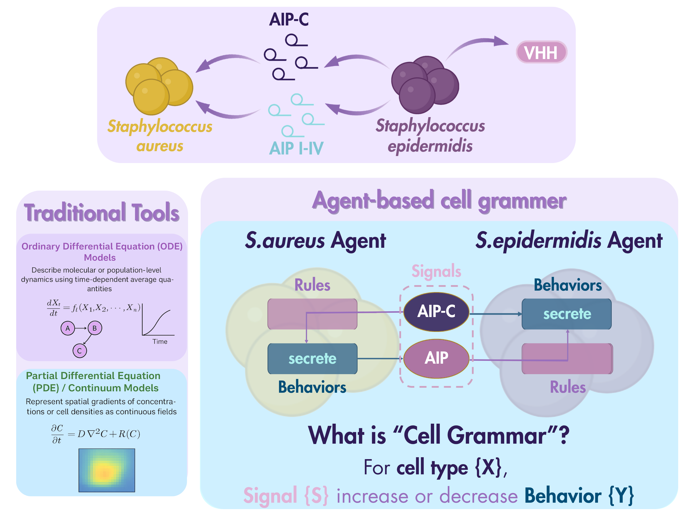
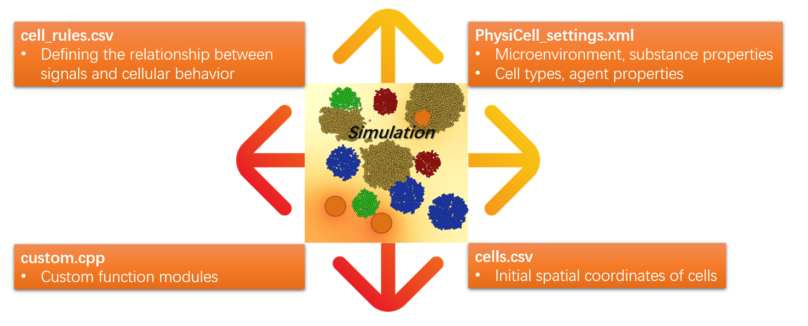
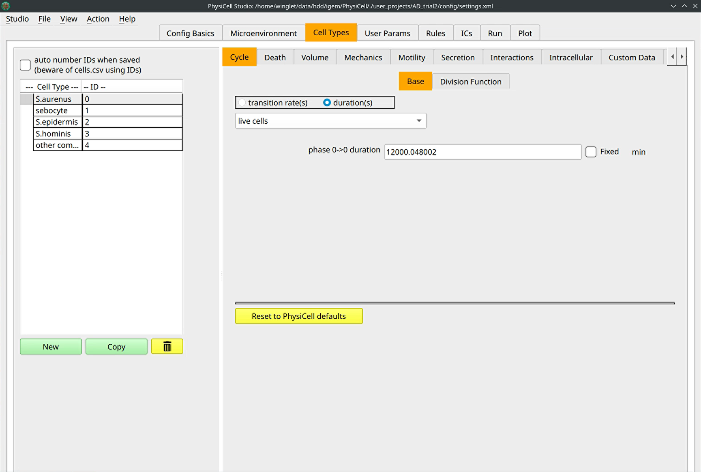

# PhysiCell1 — original wiki draft

> Converted from the locally retained source document `PhysiCell1.docx`. Original draft wording, figures and equations are preserved; see [editorial notes](../EDITORIAL_NOTES.md) before interpreting its claims.

# 2D&3D Multicellular Behavior Simulation with PhysiCell Studio

## Model Highlight

Agent-based cell behavior hypothesis grammar serves as an advanced tool for the iGEM community to simulate microbial population interactions and biofilm formation.

Model analyses indicate the engineered strain can occupy the epidermal niche and achieve long-term colonization, providing therapeutic benefit both during active disease and at relapse.

Parameter sweep identified optimal regions for the relative functional contributions of the engineered strain, offering concrete guidance for precise tuning and design optimization.

## Methodology

### Agent-Based Cell Behavior Hypothesis Grammar

<figure>

<figcaption>
<mark>fig.10 An illustration of agent-based cell grammar in our system</mark>
</figcaption>
</figure>

两个dictionary的折叠（现在打不开）

The core design of our system is the **interspecies interaction** between *S. aureus* and engineered *S. epidermidis*: AIP secreted by *S. aureus* activates the engineered *S. epidermidis* Agr system, inducing expression of AIPC (an antagonist of *S. aureus* quorum sensing) and secretion of an antibody to suppress inflammation.

For simulating inter-species interactions, classical approaches include ODE (Ordinary Differential Equation) and PDE (Partial Differential Equation). However, in our complex system, interspecies relationships are not as simple as competition or predation; spatiotemporal dynamics contain substantial stochasticity, and each cell’s behavior hypotheses are relatively complex, so **traditional methods have limited representational power**.

Therefore, we adopted an **agent-based model (ABM)**, drawing on the **latest *Cell* paper \[1\]** and adapting its approach to microbial population interactions. The model uses Hill equations as its underlying framework and a human-interpretable grammar as an explicit specification. We implement a **Cell Behavior Hypothesis Grammar** to define a specific rule set for each microbial agent, allowing us to focus on emergent, macroscopic phenomena and expand the expressive scope of the simulations.

**Simplified User Guideline for PhysiCell Studio**

To implement the modeling above, we utilized **PhysiCell Studio**, a graphical modeling tool designed to help users rapidly customize and extend simulations. However, several custom file types and the inadequacy of built-in visualization utilities create obstacles for new users. We therefore provide **a clear explanation** of PhysiCell Studio’s file structure, basic usage, and our extended visualization, to help other **iGEMers get started quickly**.

<figure>

<figcaption>
Fig.11 Four modules required for a PhysiCell Studio project
</figcaption>
</figure>

As shown, defining a PhysiCell Studio project requires **four modules**, each responsible for different functions. To create your own project, the first step is to generate its **executable**. After implementing custom modules (cell colors, substance secretion, interactions, etc.) in *custom.cpp*, please:

*make reset*

*make load PROJ=NAME*

*make*

*\#For easier organization, it is recommended to move executable files into the bin folder and name them individually; project is the name automatically generated for the executable file after compilation.*

*mv project bin/NAME*

Next, you can open a template and modify the relevant parameters in the graphical interface of PhysiCell Studio.

<figure>

<figcaption>
Fig.12 An example of the PhysiCell Studio GUI (Graphic User Interface)
</figcaption>
</figure>

Please note the different saving procedures for the various files. For *PhysiCell_settings.xml* use File → Save As; for *cells.csv* and *cell_rules.csv* simply set the correct path in the respective interface and click Save.

Next, open your project from a Linux command line with the following Python script:

*python ./studio/bin/studio.py -c ./user_projects/NAME/config/PhysiCell_settings.xml -e ./bin/NAME*

Here, *-c* specifies the project executable and *-e* specifies the project configuration file. Add *-3* at the end of the command to open a 3D project.

After the GUI opens, import *cells.csv* and *cell_rules.csv* in their respective locations.

To run a simulation, set *output/NAME* as the output folder. Click Run to generate the simulation output files in that directory.

Output types include SVG, MAT, XML, and TXT. The following section explains how to **generate a simulation video**.

*mkdir -p png*

*for f in \$(ls -1v snapshot\*.svg); do*

*printf -v num "%06d" "\$i"*

*\# -w specify the width in pixels; change to 1920 or 3840 as needed.*

*rsvg-convert -w 1920 "\$f" -o "png/frame\_\${num}.png"*

*((i++))*

*done*

*\# Please modify the image generation sequence number and frame rate.*

*ffmpeg -framerate 10 -start_number X -i frame\_%06d.png -vf "scale=1920:-2:flags=lanczos" -c:v libx264 -pix_fmt yuv420p -crf 18 -preset medium -movflags +faststart ../simulation_movie_10fps.mp4*

To facilitate subsequent analysis and visualization, we wrote a **Python visualization script** for easy access (for more information, click https://gitlab.igem.org/linnazhou/model-tools-for-2025-sjtu-biox-shanghai.git), which enables multiple functionalities.

*\# **Extract cell number***

*python ../../user_projects/AD_trial2/tools/extract_population_timeseries.py --output-dir . --out-csv population_timeseries.csv*

*\# **Extract concentration of substances in MAT**; Modify substrate id and grid-shape as needed.*

*python ../../user_projects/AD_trial2/tools/visualize_physicell_mat.py . --substrates 3 12 10 --grid-shape 50 50 1 --outdir voxel_export --no-images --export-voxels*

*\# **Visualize** the temporal evolution of **substance concentration distribution** through a heatmap video; Modify substrate id, framerate and grid-shape as needed.*

*python ../../user_projects/AD_trial2/tools/visualize_physicell_mat.py --substrates 3 10 12 --grid-shape 50 50 10 --outdir substrate --plot .*

*ffmpeg -framerate 10 -pattern_type glob -i "substrate/sub_7_t\*.png" -c:v libx264 -crf 18 -pix_fmt yuv444p substrate/sub_7.mp4*

We hope these guidelines will make PhysiCell Studio more accessible to future iGEM teams and contribute a powerful tool to the iGEM community.

\[2\]Byrd, A. L., Belkaid, Y., & Segre, J. A. (2018). The human skin microbiome. *Nat Rev Microbiol*, *16*(3), 143-155. <https://doi.org/10.1038/nrmicro.2017.157>

\[1\]Johnson, J. A. I., Bergman, D. R., Rocha, H. L., Zhou, D. L., Cramer, E., McLean, I. C., Dance, Y. W., Booth, M., Nicholas, Z., Lopez-Vidal, T., Deshpande, A., Heiland, R., Bucher, E., Shojaeian, F., Dunworth, M., Forjaz, A., Getz, M., Godet, I., Kurtoglu, F.,…Macklin, P. (2025). Human interpretable grammar encodes multicellular systems biology models to democratize virtual cell laboratories. *Cell*, *188*(17), 4711-4733 e4737. <https://doi.org/10.1016/j.cell.2025.06.048>
