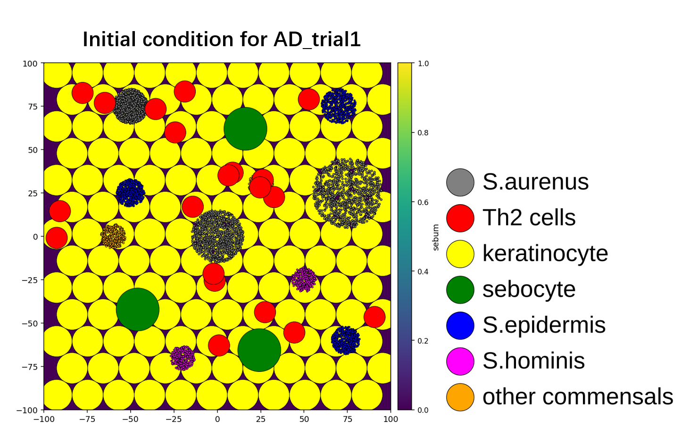
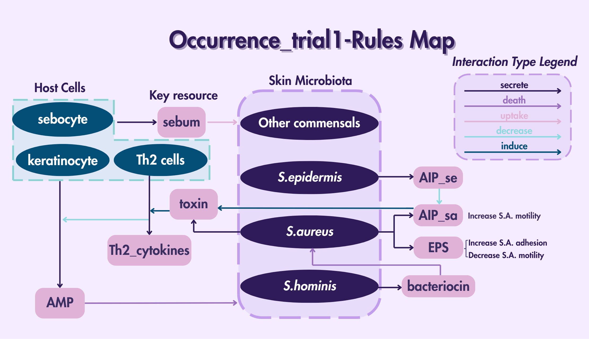
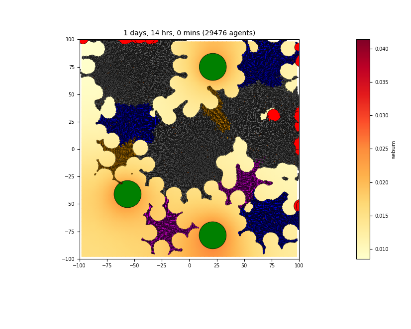
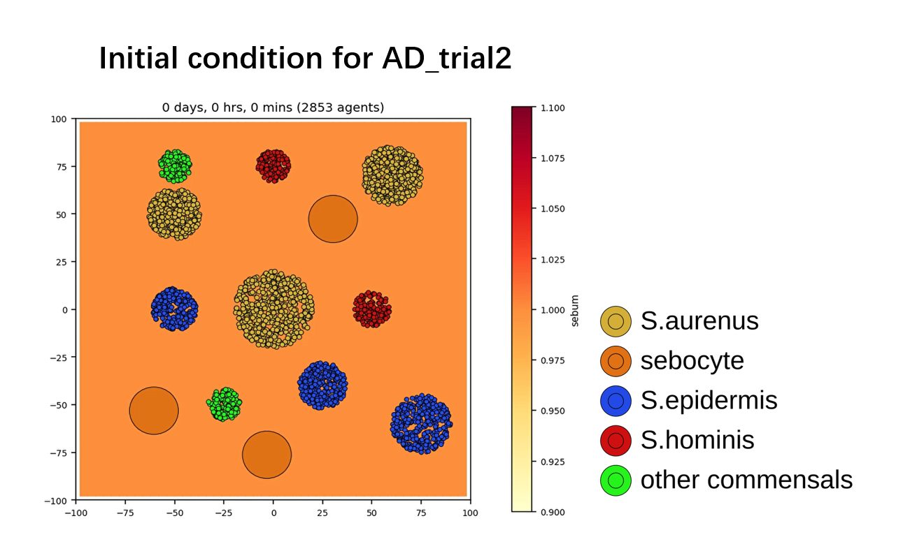
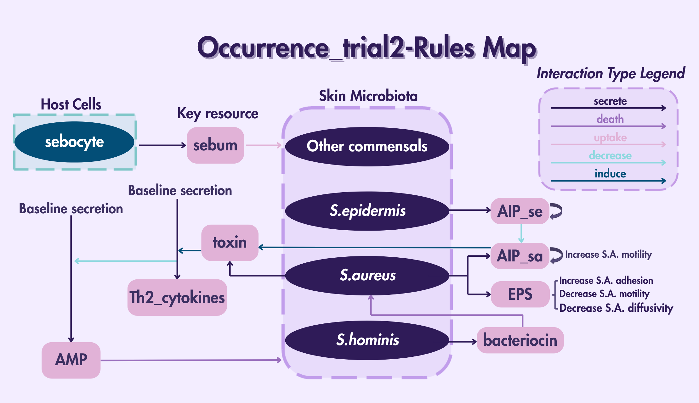
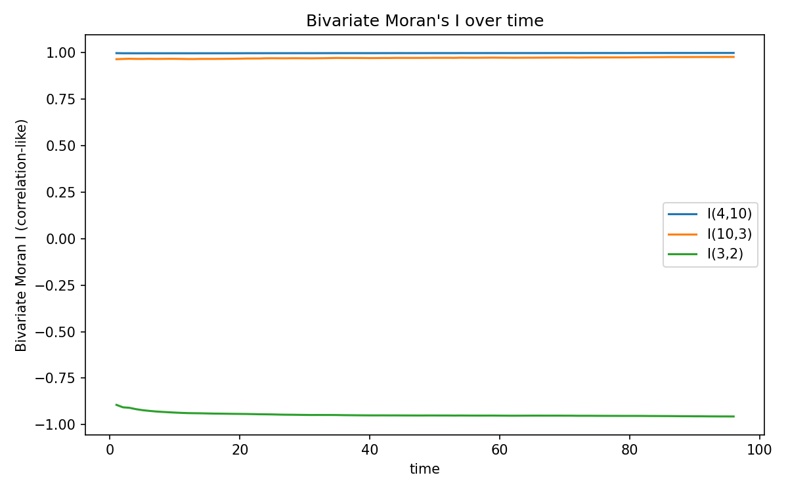
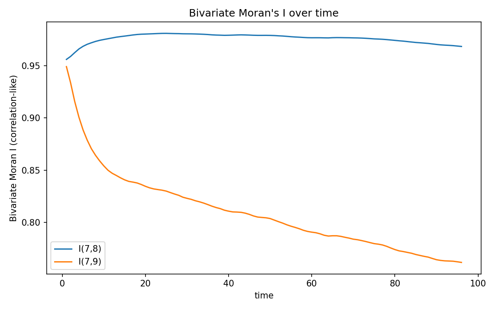

# PhysiCell2 — wiki manuscript

> Converted from the locally retained source document `PhysiCell2.docx`. Edited for portfolio readability: internal layout notes and conversion artifacts have been removed. The [published team wiki](https://2025.igem.wiki/sjtu-biox-shanghai/model) presents the final results; see [editorial notes](../EDITORIAL_NOTES.md) before interpreting its claims.

### Model Building-Occurrence Model

To determine whether our engineered *S. epidermidis* can occupy the epidermal niche and persistently colonize—and to compare whether it produces a therapeutic effect—we first construct an atopic dermatitis (AD) occurrence model to study **how the skin microbiota evolves in the absence of treatment.**

For more information, click https://gitlab.igem.org/linnazhou/model-tools-for-2025-sjtu-biox-shanghai.git

**Occurrence_trial1**

As noted earlier, a custom PhysiCell Studio project comprises **four modules**.

To **define the microenvironment and cell-type information in *PhysiCell_settings.xml***, we selected which substrates and cell types to study on the AD skin surface. Because our focus is interspecies interactions among skin microbes, literature on AD-associated taxa and *S. aureus* abundance guided the choice of ***S. aureus*, *S. epidermidis*, and *S. hominis*** as the principal species. *S. epidermidis* uses its quorum-sensing molecule (AIP_se) to interfere with the *S. aureus* Agr system; *S. hominis* produces a *S. aureus*-specific bacteriocin (Byrd et al., 2018). Other microbes are grouped as “**Other commensals**” to represent community diversity. To capture resource competition and environmental pressure, host cells include sebum-secreting **sebocytes** and **keratinocytes** that produce antimicrobial peptides (AMPs). We also include **Th2 cells** that secrete Th2 cytokines to represent the inflammatory disease state.

To determine **initial cell counts and spatial distributions (i.e., *cells.csv*)**, we performed a detailed literature review. Agent-based models of the skin microbiome remain scarce (Ceylan et al., 2025). One study (Montgomery et al., 2024) adapted the GutLogo approach by gridding the skin surface and allowing bacteria to move between grid cells as independent agents (Lin et al., 2018); however, that architecture better suits the gastrointestinal tract with continuous fluid flow. Conversely, **observations in 3D skin organoid models** show **staphylococci tending to colonize as microcolonies** (Popov et al., 2014; Wang et al., 2025). Accordingly, we randomly generate several bacterial microcolonies on the skin surface and intentionally increase *S. aureus* counts to emulate early-stage AD expansion. Because our model is 2D, host cells and microbes are placed on the same plane.

<figure>

<figcaption>
Fig.13 Initial Condition for <mark>Occurrence_trial1</mark>
</figcaption>
</figure>

Next, we create a **rule library** for the project agents by producing *cell-rules.csv*. Based on the previously described rule dictionary and the network relationships encoded in this model, we generated the rules map below. Key rules and literature references are listed in the accompanying table：

| Cell type | Signal | Impact | Behavior | Reference |
|:--:|:--:|:--:|:--:|:--:|
| Keratinocyte | Th2_cytokine | decrease | AMP secretion | (Ong et al., 2002) |
| *S.aureus* | AIP-sa | increase | motility | (Kong et al., 2006) |
| *S.aureus* | AIP-se | decrease | AIP_sa secretion | (Williams et al., 2023) |
| Th2 cells | toxin | increase | Th2 cytokine secretion | (Yamada et al., 2023) |

<figure>

<figcaption>
Fig.14 Rules Map for Occurrence_trial1
</figcaption>
</figure>

For *Occurrence_trial1* we did not add any custom modules to *custom.cpp*.

We then ran the simulation and obtained the following visualization:

<figure>

<figcaption>
Fig.15 A Simulation Snapshot for Occurrence_trial1
</figcaption>
</figure>

The colonies appeared as abnormal star-shaped structures with circular gaps around them. Examination of the simulation movie revealed the cause.

[Movie 1: Occurrence_trial1 simulation](https://video.igem.org/videos/embed/kkWxTifyQ1WS5BF9Bc3tJp)

**hints**

Because host cells and microbes were placed in the **same plane**, **virtual wall nudging**, keratinocyte compression, and T-cell motility created many punched-out gaps, producing unrealistic colony morphologies. We also observed that, when scaled to realistic conditions, agent counts rapidly rose into the tens of thousands, imposing **prohibitive computational cost**. We therefore adjusted the setup and conducted **a second round of experiments**.

**Occurrence_trial2**

Based on the *Occurrence_trial1* results, we implemented **the following optimizations:**

**1. Remove Th2 cells and keratinocytes; make cytokine and AMP globally secreted.\**
To avoid spurious mechanical interactions the ideal solution is a [3D simulation](physicell3.md#model-building-3d-model). As an alternative here, we edited *custom.cpp* to convert cytokine and AMP into globally secreted fields, replacing the former agent-based rules with reaction equations for the substances as described below.

AMP += AMP_baseline_rate \* dt

Cytokine += Cytokine_baseline_rate \* dt

Cytokine += toxin_to_cytokine_rate \* toxin \* dt

AMP -= cytokine_to_AMP_degradation_rate \* cytokine \* dt

**2. Reduce agent counts to lower computational cost.**

Because many microbial behaviors are emergent at the macro scale, we assume that reducing agent numbers by one order of magnitude within a reasonable range will not materially alter macroscopic system dynamics.

**3. Add biofilm modeling for *S. aureus*.**

In the *Occurrence_trial1* movie, *S. aureus* colonies were highly compact and non-diffusive. Literature links *S. aureus* Agr signaling and biofilm disruption to invasion and tissue damage {Peng, 2022}. Accordingly, we added secretion of Extracellular Polymeric Substances (EPS) to model biofilm formation. EPS reduces *S. aureus* motility and increases cell–cell adhesion. To represent the protective effect of EPS on reducing diffusional access to *S. aureus*, we implemented in *custom.cpp* a process whereby two key killing agents—**AMP and bacteriocin—are “captured” by EPS：**

AMP + EPS --(k_bind_amp)--\> AMP_bound (immobilized)

Bacteriocin + EPS --(k_bind_bac)--\> Bacteriocin_bound (immobilized)

uptake_AMP = min( k_bind_amp \* \[EPS\] \* \[AMP\] \* dt , max_fraction_removed \* \[AMP\] )

uptake_bac = min( k_bind_bac \* \[EPS\] \* \[bacteriocin\] \* dt , max_fraction_removed \* \[bacteriocin\] )

\[AMP\] \<- \[AMP\] - uptake_AMP

\[bacteriocin\] \<- \[bacteriocin\] - uptake\_ bacteriocin

Reactions occur in each voxel.

Once AMP and bacteriocin are sequestered by EPS they can no longer move and their effective concentrations are reduced, so EPS acts as an absorptive sink that shields *S. aureus*.

**4. Add positive-feedback amplification of the AIP quorum-sensing signal.**

After these modifications, the initial cell morphology distribution and the rule map are as follows:

<figure>

<figcaption>
Fig.16 Initial Condition for Occurrence_trial2
</figcaption>
</figure>

<figure>

<figcaption>
Fig.17 Rules Map for Occurrence_trial2
</figcaption>
</figure>

To verify that our core rules hold in this complex multicellular system, we used the **bivariate Moran’s I** (Wartenberg, 1985) to **test the spatial correlation between relevant substances**.

The bivariate Moran coefficient measures the spatial association between one variable at a location and another variable in that location’s neighborhood — i.e., whether “high/low values of x at a site are accompanied by high/low values of y in neighboring sites.” The statistic ranges in \[−1,1\]: positive values indicate positive association (high–high or low–low across variables and neighbors), while negative values indicate negative association (high–low or low–high). The bivariate Moran’s I is computed as follows:

I\_{xy} = \frac{n}{\mathcal{S}\_{0}} \cdot \frac{\sum\_{i} \sum\_{j} w\_{ij} (x\_{i} - \bar{x}) (y\_{j} - \bar{y})}{\sum\_{i} (x\_{i} - \bar{x})^{2}}

where n is the number of observation locations; x=(x1,…,xn)′and y=(y1,…,yn)′are the observed values of the two variables (they need not be the same type). Wij denotes an element of the spatial weight matrix W. S0​ is the sum of the weights. It is straightforward to see that Ixy​ measures the covariance between xxx and Wy.

We implemented this calculation in a Python script for convenient reuse.

*python ../../user_projects/Occurrence_trial2/tools/visualize_physicell_mat.py . --substrates 7 8 9 --grid-shape 50 50 1 --bivar-moran-pairs 7,8 8,9 --bivar-moran-norm xy --bivar-moran-output moran_biofilm --outdir substrate*

First, we validated whether the model successfully reproduces the ***S. aureus* AD pathogenic chain — AIP_sa (4) → toxin (10) → cytokine (3) → AMP (2)**. We then computed the bivariate Moran’s I for the substances along this logical chain.

<figure>

<figcaption>
Fig.18 Bivariate Moran’s I for Pathogenic Chain of Occurrence_trial2
</figcaption>
</figure>

The substances in *S. aureus*’s AD pathogenic circuit exhibit strong spatial correlation, and the strongest association occurs between molecules secreted by the same agent type (AIP_sa → toxin). This provides clear evidence that the model successfully reproduces the *S. aureus* AD pathogenic pathway.

Next, we tested whether **EPS effectively sequesters AMP and bacteriocin**, thereby recapitulating biofilm functionality. We computed the bivariate Moran’s I for **EPS (7) → AMP_bound (8) and EPS (7) → bacteriocin_bound (9)** as follows:

<figure>

<figcaption>
Fig.19 Bivariate Moran’s I for Biofilm Simulation of Occurrence_trial2
</figcaption>
</figure>

The results show that EPS and the bound forms of AMP and bacteriocin (AMP_bound, bacteriocin_bound) all have spatial correlations above 0.75, indicating EPS effectively sequesters these molecules. The reduced spatial correlation of bacteriocin_bound may reflect changes in the spatial relationship between *S. hominis* and *S. aureus*.

Byrd, A. L., Belkaid, Y., & Segre, J. A. (2018). The human skin microbiome. *Nat Rev Microbiol*, *16*(3), 143-155. <https://doi.org/10.1038/nrmicro.2017.157>

Ceylan, S., Demir, D., Harris, C., Ipek, S. L., Vavourakis, V., Manca, M., Dubrac, S., & Bauer, R. (2025). Skin in the game: a review of computational models of the skin. *Biodata Mining*, *18*(1), 55. <https://doi.org/10.1186/s13040-025-00471-8>

Johnson, J. A. I., Bergman, D. R., Rocha, H. L., Zhou, D. L., Cramer, E., McLean, I. C., Dance, Y. W., Booth, M., Nicholas, Z., Lopez-Vidal, T., Deshpande, A., Heiland, R., Bucher, E., Shojaeian, F., Dunworth, M., Forjaz, A., Getz, M., Godet, I., Kurtoglu, F.,…Macklin, P. (2025). Human interpretable grammar encodes multicellular systems biology models to democratize virtual cell laboratories. *Cell*, *188*(17), 4711-4733 e4737. <https://doi.org/10.1016/j.cell.2025.06.048>

Kong, K. F., Vuong, C., & Otto, M. (2006). Staphylococcus quorum sensing in biofilm formation and infection. *Int J Med Microbiol*, *296*(2-3), 133-139. <https://doi.org/10.1016/j.ijmm.2006.01.042>

Lin, C., Culver, J., Weston, B., Underhill, E., Gorky, J., & Dhurjati, P. (2018). GutLogo: Agent-based modeling framework to investigate spatial and temporal dynamics in the gut microbiome. *PLoS One*, *13*(11), e0207072. <https://doi.org/10.1371/journal.pone.0207072>

Montgomery, V. A., Wood-Yang, A. J., Styczynski, M. P., & Prausnitz, M. R. (2024). Feasibility of engineered Bacillus subtilis for use as a microbiome-based topical drug delivery platform. *Bioeng Transl Med*, *9*(4), e10645. <https://doi.org/10.1002/btm2.10645>

Ong, P. Y., Ohtake, T., Brandt, C., Strickland, I., Boguniewicz, M., Ganz, T., Gallo, R. L., & Leung, D. Y. (2002). Endogenous antimicrobial peptides and skin infections in atopic dermatitis. *N Engl J Med*, *347*(15), 1151-1160. <https://doi.org/10.1056/NEJMoa021481>

Peng, Q., Tang, X., Dong, W., Sun, N., & Yuan, W. (2022). A Review of Biofilm Formation of Staphylococcus aureus and Its Regulation Mechanism. *Antibiotics (Basel)*, *12*(1). <https://doi.org/10.3390/antibiotics12010012>

Popov, L., Kovalski, J., Grandi, G., Bagnoli, F., & Amieva, M. R. (2014). Three-Dimensional Human Skin Models to Understand Staphylococcus aureus Skin Colonization and Infection. *Front Immunol*, *5*, 41. <https://doi.org/10.3389/fimmu.2014.00041>

Wang, P., Li, H., Zhang, X., Wang, X., Sun, W., Zhang, X., Chi, B., Go, Y., Chan, X. H. F., Wu, J., & Huang, Q. (2025). Microecology in vitro model replicates the human skin microbiome interactions. *Nature Communications*, *16*(1), 3085. <https://doi.org/10.1038/s41467-025-58377-2>

Wartenberg, D. (1985). Multivariate Spatial Correlation - a Method for Exploratory Geographical Analysis. *Geographical Analysis*, *17*(4), 263-283. <https://doi.org/DOI> 10.1111/j.1538-4632.1985.tb00849.x

Williams, P., Hill, P., Bonev, B., & Chan, W. C. (2023). Quorum-sensing, intra- and inter-species competition in the staphylococci. *Microbiology (Reading)*, *169*(8). <https://doi.org/10.1099/mic.0.001381>

Yamada, H., Kaitani, A., Izawa, K., Ando, T., Kamei, A., Uchida, S., Maehara, A., Kojima, M., Yamamoto, R., Wang, H., Nagamine, M., Maeda, K., Uchida, K., Nakano, N., Ohtsuka, Y., Ogawa, H., Okumura, K., Shimizu, T., & Kitaura, J. (2023). Staphylococcus aureus delta-toxin present on skin promotes the development of food allergy in a murine model. *Front Immunol*, *14*, 1173069. <https://doi.org/10.3389/fimmu.2023.1173069>
