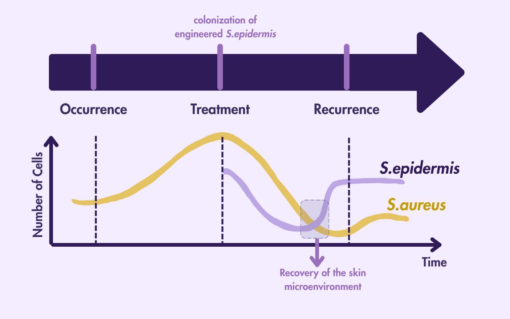
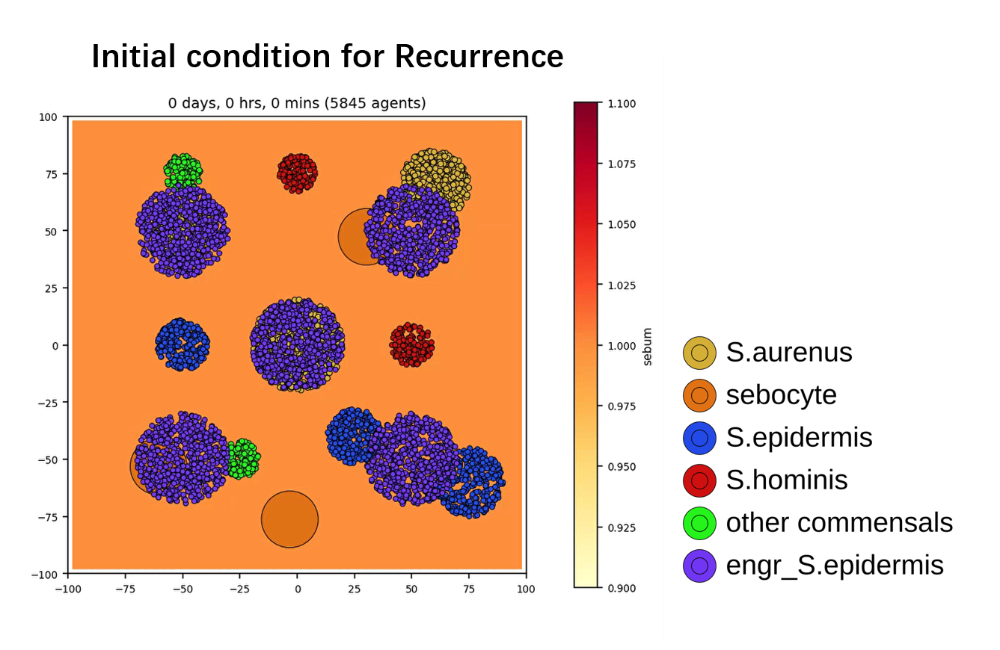
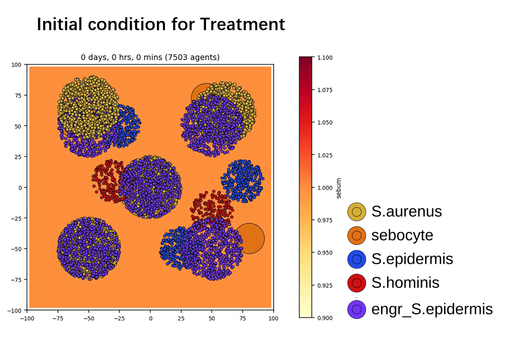
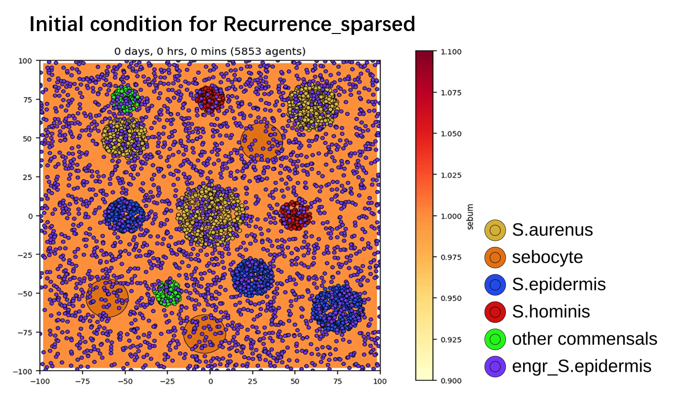
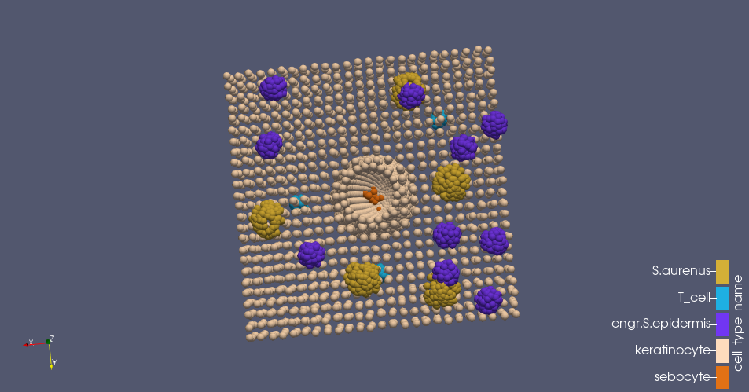
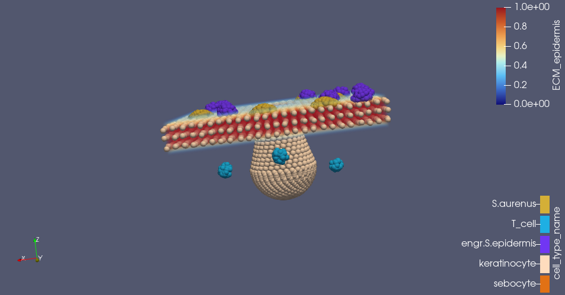
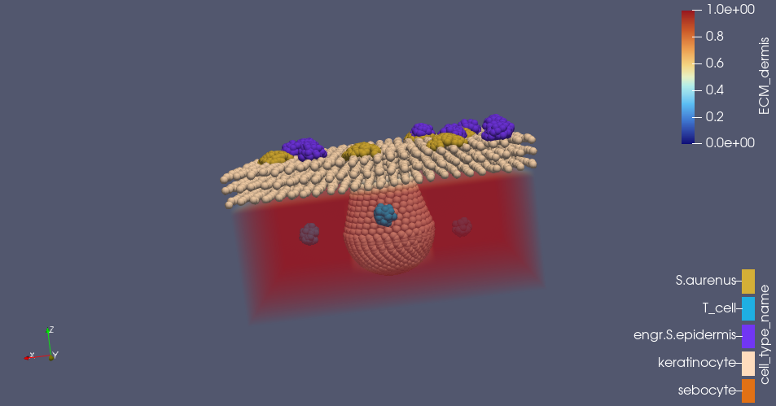

# PhysiCell3 — wiki manuscript

> Converted from the locally retained source document `PhysiCell3.docx`. Edited for portfolio readability: internal layout notes and conversion artifacts have been removed. The [published team wiki](https://2025.igem.wiki/sjtu-biox-shanghai/model) presents the final results; see [editorial notes](../EDITORIAL_NOTES.md) before interpreting its claims.

### Model Building-Recurrence and Treatment Model

Next, we will establish models **featuring engineered *S.epidermidis*** to verify whether it can exert therapeutic effects.

For this section we constructed **two distinct models** depending on **disease status**.



Caption: Fig.20 Correspondence between the model and disease stages as well as changes in microbial counts

- **The *Recurrence* model** simulates **disease relapse** when ***S. aureus* abundance is low** and the cell initial conditions match those in the *Occurrence* model. The *Recurrence* model is intended for comparison with *Occurrence* to test **whether a long-term resident engineered strain can suppress disease development at early AD reactivation**.

- **The *Treatment* model** focuses on a **more severe disease state** with **higher initial *S. aureus* counts**; it tests **whether the engineered strain can occupy the epidermal niche on AD skin**.

Accordingly, the **initial cell distributions** for the two models are shown in the figure below.



Fig.21(a) Initial Condition for Recurrence



Fig.21(b) Initial Condition for Treatment

In addition, because the post-colonization spatial arrangement of the engineered *S. epidermidis* is uncertain, we also tested an **alternative scenario** where the same number of engineered S.epidermis is **uniformly dispersed** across the domain to evaluate whether spatial distribution affects colonization and therapeutic outcome



Fig.22 Initial Condition for Recurrence_sparsed

For both models’ ***cell_rules.**csv,* we added an agent type *engr_S.epidermis* (green in the figure). This **engineered agent** responds to AIP_sa by secreting vHH and AIP_C. AIP_C reduces secretion of AIP_sa and toxin by *S. aureus*, while vHH suppresses T-cell cytokine secretion via feedback regulation (Kim et al., 2019).


Fig.23 Rules Map for Recurrence and Treatment Model

Notably, **for the rule “AIP_C inhibits *S. aureus* toxin secretion,” the Hill equation half-max was informed by wet-lab data** (see hemolysis assay of AIP-C potency). The experiment showed that the IC₅₀ in the presence of *S. aureus* culture supernatant was 1.5× that of the control, from which we infer that AIP-C reduces hemolysin concentration to roughly two-thirds of its original level. Accordingly, the Hill half-max for AIP_C inhibition of *S. aureus* toxin secretion was set to 0.667 (unitless).

### Model building-3D model

During model development we found that **microcolony spatial relationships strongly influence outcomes**. We attribute this sensitivity largely to PhysiCell’s use of BioFVM for spatial transport.

**BioFVM** (Ghaffarizadeh et al., 2016) is an open-source **3D multi-substrate transport solver** designed for tissue and cell simulations and integrated into PhysiCell to update the biochemical microenvironment. For each diffusing substrate c(x,t), BioFVM solves the standard **reaction–diffusion–decay PDE** with bulk and cellular sources or sinks.

```math
\frac{\partial c(\mathbf{x}, t)}{\partial t} = \nabla \cdot (D(\mathbf{x}) \nabla c(\mathbf{x}, t)) - \lambda(\mathbf{x}) c(\mathbf{x}, t) + S_{\mathrm{bulk}}(\mathbf{x}, t) + S_{\mathrm{cells}}(\mathbf{x}, t)
```

In that formulation, D(x) is the diffusion coefficient, λ(x) is the first-order decay rate, S<sub>bulk</sub> ​represents bulk sources or sinks, and S<sub>cells</sub> represents cell-level production or uptake.

Because many interactions in our **rule set** are **mediated by field diffusion** and thus strongly space-dependent, and because **host-cell behaviors** substantially affect the skin microbiota, we **extended the simulation domain to 3D** to more realistically model community dynamics and to further validate our conclusions.

To construct the 3D model, we consulted a review (Weidinger et al., 2018) and chose to simulate the **epidermis and superficial dermis**. The epidermis is represented by three layers of keratinocytes; microcolonies of *S. aureus* and engineered *S. epidermidis* are placed atop the epidermis; T-cell clusters reside in the dermis; a recessed, sac-like sebaceous gland is formed beneath the epidermis with sebocytes located at the gland base. Literature references for the dimensions of layers and cell types are provided in the table below.

|    Cell type    |         Reference          |
|:---------------:|:--------------------------:|
| sebaceous gland | (Veniaminova et al., 2023) |
|  keratinocyte   |    (Sun & Green, 1976)     |
|     T cells     |    (Wang et al., 2014)     |



Fig.24(a) Top View of the 3D Model


Fig.24(b) Side View of the 3D Model

Additionally, to model the **barrier properties** of the epidermal and dermal tissues we adopted an approach analogous to our EPS/biofilm treatment (<span class="mark">see *Occurrence_trial2*)</span>. We filled the three keratinocyte layers with **ECM_epidermis** and the dermis with **ECM_dermis**, and used a similar “capture” mechanism to suppress transport of diffusing substances within these regions.





Fig.25(a,b) Barrier Field of the 3D Model; Left, ECM_epidermis; Right, ECM_dermis.

Ghaffarizadeh, A., Friedman, S. H., & Macklin, P. (2016). BioFVM: an efficient, parallelized diffusive transport solver for 3-D biological simulations. *Bioinformatics*, *32*(8), 1256-1258. <https://doi.org/10.1093/bioinformatics/btv730>

Kim, J. E., Jung, K., Kim, J. A., Kim, S. H., Park, H. S., & Kim, Y. S. (2019). Engineering of anti-human interleukin-4 receptor alpha antibodies with potent antagonistic activity. *Sci Rep*, *9*(1), 7772. <https://doi.org/10.1038/s41598-019-44253-9>

Sun, T. T., & Green, H. (1976). Differentiation of the epidermal keratinocyte in cell culture: formation of the cornified envelope. *Cell*, *9*(4 Pt 1), 511-521. <https://doi.org/10.1016/0092-8674(76)90033-7>

Veniaminova, N. A., Jia, Y. Y., Hartigan, A. M., Huyge, T. J., Tsai, S. Y., Grachtchouk, M., Nakagawa, S., Dlugosz, A. A., Atwood, S. X., & Wong, S. Y. (2023). Distinct mechanisms for sebaceous gland self-renewal and regeneration provide durability in response to injury. *Cell Rep*, *42*(9), 113121. <https://doi.org/10.1016/j.celrep.2023.113121>

Wang, M., Misakian, M., He, H. J., Bajcsy, P., Abbasi, F., Davis, J. M., Cole, K. D., Turko, I. V., & Wang, L. (2014). Quantifying CD4 receptor protein in two human CD4+ lymphocyte preparations for quantitative flow cytometry. *Clin Proteomics*, *11*(1), 43. <https://doi.org/10.1186/1559-0275-11-43>

Weidinger, S., Beck, L. A., Bieber, T., Kabashima, K., & Irvine, A. D. (2018). Atopic dermatitis. *Nat Rev Dis Primers*, *4*(1), 1. <https://doi.org/10.1038/s41572-018-0001-z>
