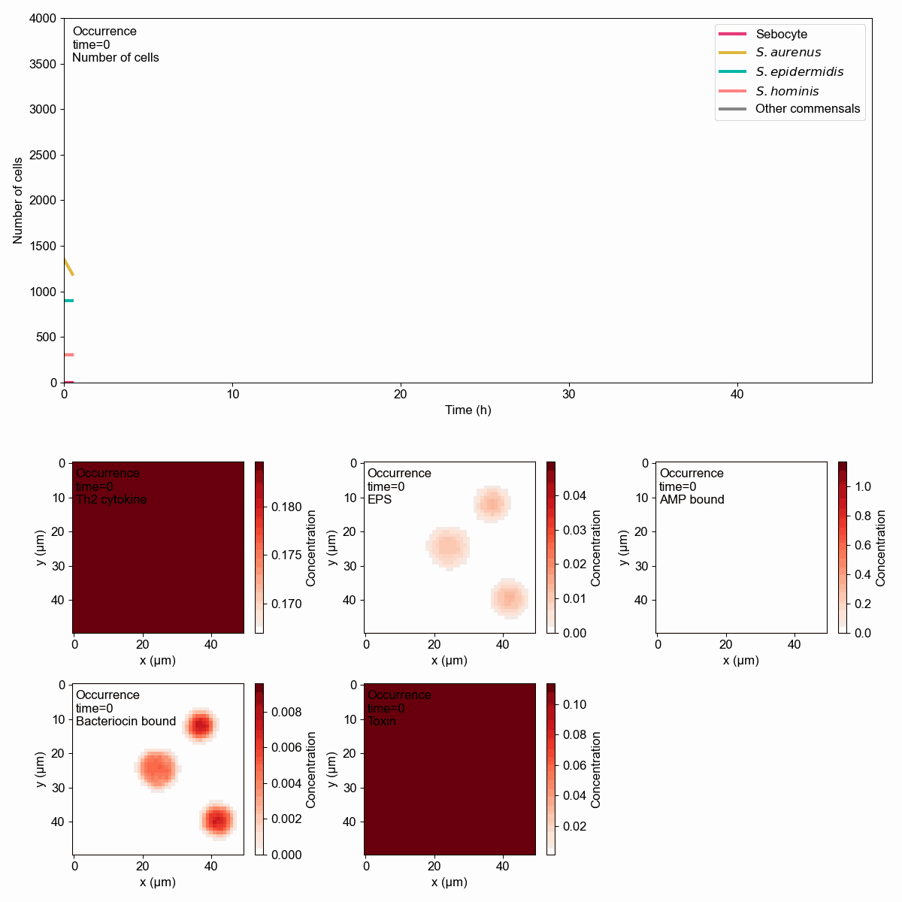
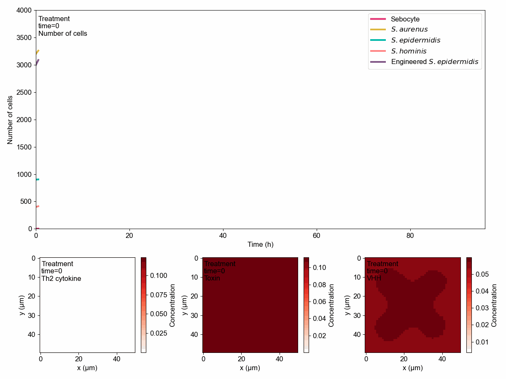
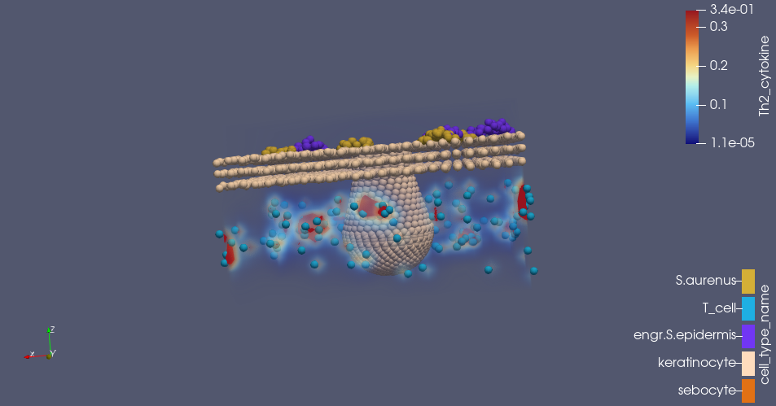
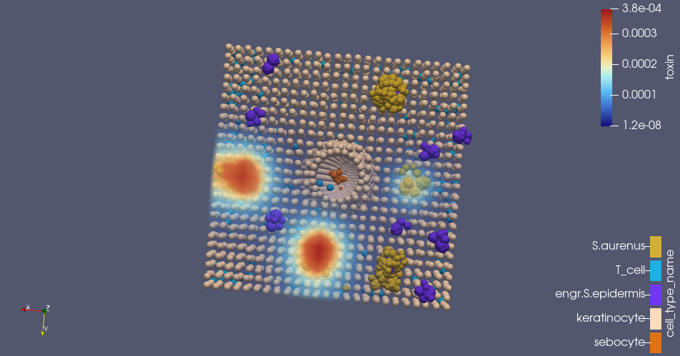
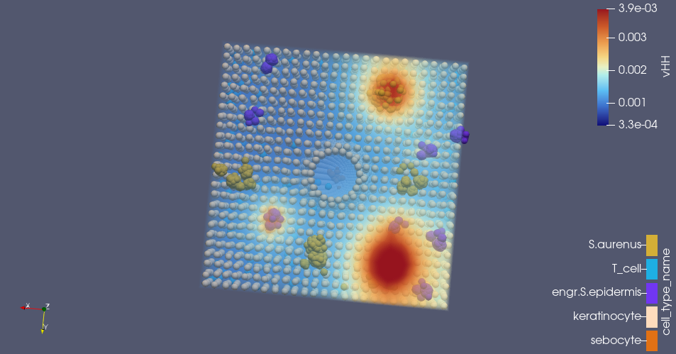
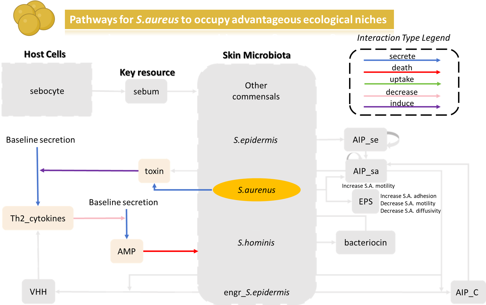
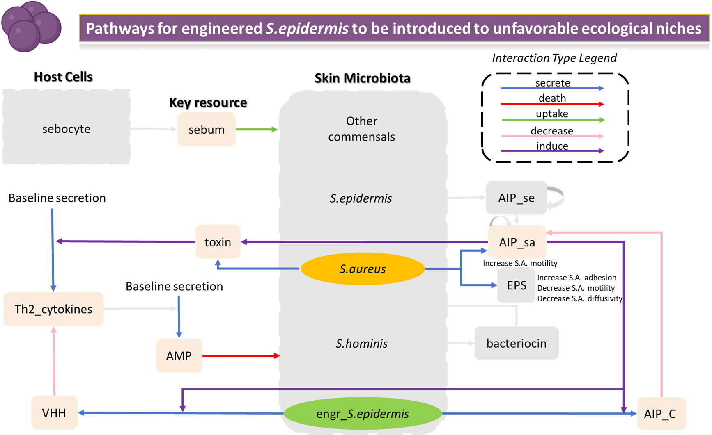
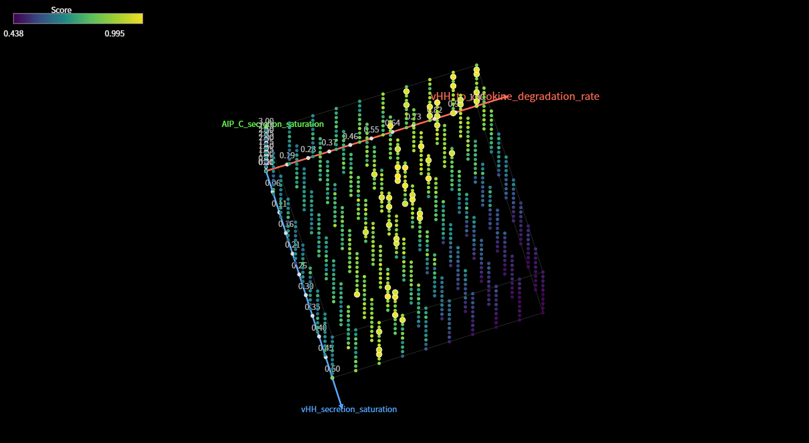

# PhysiCell4 — original wiki draft

> Converted from [PhysiCell4.docx](../originals/PhysiCell4.docx). Original draft wording, figures and equations are preserved; see [editorial notes](../EDITORIAL_NOTES.md) before interpreting its claims.

### Results-Validation of the Planting and Treatment Capacity

**2D-Ocurrence, Recurrence and Treatment Models**

- First, by comparing the ***Occurrence* and *Recurrence* models**, we validated the engineered strain’s **therapeutic efficacy.**

Fig.27: Simulation Movie for Occurrence Model（此处放AD_trial2 movie）

Fig. 28: Simulation Movie for Recurrence Model（此处放Recurrence movie）

In the ***Occurrence* model**, when no engineered *S. epidermidis* is present, ***S. aureus* microcolonies expand** continuously and show signs of **biofilm-mediated rupture and invasion**. **T-cell cytokine** concentrations also remain **high**, indicating an inflamed microenvironment.

In contrast, in the **recurrence model**, the **engineered *S. epidermidis* persistently suppresses *S. aureus* growth**, resulting in both populations remaining near steady state. Consequently, **T-cell cytokine levels stay low**, indicating effective disease control.

<figure>

<figcaption>
Fig. 29 Changes in population plot and substance concentration in the Occurrence Model
</figcaption>
</figure>

<figure>

<figcaption>
Fig. 30 Changes in population plot and substance concentration in the Recurrence Model
</figcaption>
</figure>

As shown, population plots of cell counts again confirm suppression by the engineered strain. **Field simulations** show that in ***Occurrence***, **toxin concentration rises** with increasing *S. aureus* abundance (visible after ~40 h); in ***Recurrence***, toxin remains below visible levels, **cytokine levels decline** overall, and show clear **spatial correlation with VHH**.

In the *Occurrence* spatial fields we also observe successful **biofilm modeling**: after EPS-defined biofilms form, AMP is rapidly trapped and the spatial extent of bacteriocin_bound expands.

- Next, we used the ***Treatment* model** to test the engineered strain’s ability to **occupy the niche** and establish **long-term colonization**.

Fig.31: Simulation Movie for Treatment Model（此处放Treatment movie）

The simulation movie shows that during an **AD flare** when ***S. aureus* dominates**, environmental resources are heavily consumed by *S. aureus* and **cytokine levels are high**. **Massive seeding of *S. epidermidis* instantly reduces cytokine** concentrations, but may **exceed** the system’s **carrying capacity**, causing large-scale microbial mortality and a transition to a new steady state. After stabilization, the **engineered strain persists**, although cytokine levels show some oscillation.

<figure>

<figcaption>
Fig. 32 Changes in population plot and substance concentration in the Treatment Model
</figcaption>
</figure>

As shown, after colonization **engineered *S. epidermidis* secretes abundant VHH**, rapidly lowering T-cell cytokine and toxin concentrations and achieving successful establishment. However, **around ~60 h post-colonization cytokine levels rebound while VHH declines**, indicating that colonization alone may not sustain therapeutic control in severe AD. Therefore for **severe AD** we still recommend **subcutaneous antibody injection** combined with our **engineered strain as adjuvant therapy to prevent relapse**.

**3D-Ocurrence and Recurrence Models**

As the 2D results suggested that the engineered strain was **better suited to preventing relapse than treating severe AD**, we **only** used 3D simulations to study the strain’s role in **recurrence**.

Fig.33(a)/(b) 3D Simulation Movie with Th2 cytokine; left, Occurrence 3D; right, Recurrence 3D此处左右放AD_cytokine, Lesion_cytokine

Fig.34(a)/(b) 3D Simulation Movie with toxin; left, Occurrence 3D; right, Recurrence 3D此处左右放AD_toxine, Lesion_toxin

In terms of concentration fields, **cytokine and toxin ranges** in the ***Recurrence*** 3D model (with engineered strain) are **lower** than in the *Occurrence* 3D model. Spatially, **T-cell cytokines** tend to **cluster in the dermis**, whereas **toxin** shows **localized bursts within *S. aureus*** populations at the **skin surface**; *S. aureus* colonies that are spatially distant from engineered *S. epidermidis* are more prone to such toxin outbreaks.

<figure>

<figcaption>
fig.35 A Snapshot for Th2 Cytokine in Recurrence 3D Model
</figcaption>
</figure>

<figure>

<figcaption>
fig.36 A Snapshot for Toxin in Recurrence 3D Model
</figcaption>
</figure>

Interestingly, **VHH** secretion also manifests as **localized bursts** from *S. epidermidis*, temporally and spatially **responding to nearby *S. aureus* toxin eruptions** — vividly demonstrating the switch’s responsive behavior.

<figure>

<figcaption>
Fig.37 3D Simulation Movie with VHH in Recurrence 3D<mark>此处放Lesion_VHH</mark>_video
</figcaption>
</figure>

fig.38 A Snapshot for VHH in Recurrence 3D Model at the same timepoint as fig.5.

Note: The S.aureus colonies at the two right-side outbreak sites are mixed with S.epidermidis

### Results- Optimal Regions for the Functional Contributions 

When we adjusted the parameters of the *Recurrence* model, we found that **changes in the population sizes** of *S.aureus* and the engineered *S.epidermis* were **highly sensitive to** the **proportion of functional modules** in the **engineered strain**.

Reviewing the recurrence rule set shows that ***S. aureus*** secretes a **toxin** that **stimulates cytokines**, thereby **reducing AMP** production locally and creating **a more favorable niche**. Conversely, the **engineered strain** secretes **VHH** to **reduce** inflammatory **cytokines**, which indirectly **promotes** local **AMP** production that is **detrimental to the engineered strain itself**.

Therefore, if **VHH** secretion or action is **too strong**, the engineered S. epidermidis strain can be rapidly **killed by the resulting AMP surge**. Conversely, if VHH secretion or action is **too weak**, the strain **cannot achieve a therapeutic effect**. Similarly, **AIP-C secretion requires precise adjustment**: increasing AIP-C reduces S. aureus invasion and toxin secretion (which is beneficial for the survival of the engineered strain), but excessive AIP-C can reduce the effectiveness of AIP_sa and limit its ability to promote AMP production.

<figure>

<figcaption>
Fig.39 Pathways for <em>S.aureus</em> to Occupy Advantageous Ecological Niches
</figcaption>
</figure>

<figure>

<figcaption>
Fig.40 Pathways for engineered <em>S.epidermis</em> to be introduced to unfavorable ecological niches
</figcaption>
</figure>

Therefore, **both VHH and AIP-C require fine-tuning to find an optimal parameter regime.**

After preliminary calibration, we performed a uniform scan over **three key parameters**:

| Parameter | Range | Number of samples |
|:--:|:--:|:--:|
| VHH_to_cytokine_degradation_rate | \[0.1,1\] | 10 |
| Saturation value for the increase of AIP_sa on AIP-C secretion for engr\_*S.epidermis* | \[0.5,3\] | 10 |
| Saturation value for the increase of AIP_sa on VHH secretion for engr\_*S.epidermis* | \[0.01,0.5\] | 10 |

Next, we built a 10×10×10 parameter space. To map the optimal surface, we defined a **scoring metric** for each simulation. The ideal target state is as follows: **S. aureus** **(A)** s**hould remain constant** (Ai ≈ Ao) with only minor fluctuations; sustained increases or large spikes are undesirable. **Engineered S. epidermidis** **(E) should not decrease** — it should preferably remain constant or increase slightly (Ei ≥ Eo); sustained decline or large drops are undesirable.

Let the time series have N points: t_0 \< t_1 \< … \< t\_{N-1}. Define Ai = *S. aureus* count at ti and Ei = *S. epidermidis* count at ti; total span T = t\_{N-1} − t_0. To avoid division by zero, set a tiny ε = 1e−9.

We combined three components into a composite penalty score to measure deviation from the ideal:

**1. Average Baseline Deviation** (only penalize undesired direction)

For A (only upward deviations):

D\_{A} = \frac{1}{N} \sum\_{i=0}^{N-1} \mathrm{max} \left( 0, \frac{A\_{i} - A\_{0}}{A\_{0} + \varepsilon} \right)

For E (only downward deviations):

D\_{E} = \frac{1}{N} \sum\_{i=0}^{N-1} \max \left(0, \frac{E_0 - E_i}{E_0 + \varepsilon} \right)

**2. Net trend** (endpoint vs. start; captures overall direction)

For A (penalize final \> initial):

T\_{A} = \mathrm{max} \left( 0, \frac{A\_{N-1} - A\_{0}}{A\_{0} + \varepsilon} \right)

For E (penalize final \< initial):

T\_{E} = \max \left(0, \frac{E_0 - E\_{N-1}}{E_0 + \varepsilon} \right)

**3. Cumulative single-step direction violations** (local directionality)

For A (sum of all positive single-step increases):

V\_{A} = \frac{\sum\_{i=1}^{N-1} \max(0, A_i - A\_{i-1})}{A_0(N - 1) + \varepsilon}

For E (sum of all negative single-step decreases):

V\_{E} = \frac{\sum\_{i=1}^{N-1} \max(0, E\_{i-1} - E_i)}{E_0(N - 1) + \varepsilon}

**Overall penalty:**

P = w\_{A}^{D} D\_{A} + w\_{A}^{T} T\_{A} + w\_{A}^{V} V\_{A} + w\_{E}^{D} D\_{E} + w\_{E}^{T} T\_{E} + w\_{E}^{V} V\_{E}

We set trend (T) and average deviation (D) with similar importance and direction violations (V) slightly lower:

w_A^D = 1, w_A^T = 1, w_A^V = 0.5

w_E^D = 1, w_E^T = 1, w_E^V = 0.5

Scores were mapped to \[0,1\] by an inverse transform:

\mathrm{Score} = \frac{1}{1 + P'}

<figure>

<figcaption>
Fig.41 Parameter Scan Score Space
</figcaption>
</figure>

As shown, we obtained a scored parameter space and highlighted the top 5% scoring points.

<figure>

<figcaption>
Fig.42 Top View of the Parameter Scan Score Space
</figcaption>
</figure>

From the top view of the parameter space, **the optimal points are concentrated where the VHH-to-cytokine-degradation-rate and VHH-secretion-saturation are balanced**, while the effect of AIP-C-secretion-saturation is relatively smaller. A much larger score drop is caused by excessive VHH than by VHH insufficiency, indicating that **overly strong antibody activity perturbs the skin microbiome more severely and may induce immune drift**. (de Wijs et al., 2020).

Consequently, these results guide **downstream strain optimization**: it is critical to **measure VHH_to_cytokine_degradation_rate accurately** and to **directionally tune VHH_secretion_saturation** (for example via P3 promoter engineering or VHH amino-acid sequence modification) so the engineered strain can achieve a suitable compromise between colonization and suppression functions.

de Wijs, L. E. M., Nguyen, N. T., Kunkeler, A. C. M., Nijsten, T., Damman, J., & Hijnen, D. J. (2020). Clinical and histopathological characterization of paradoxical head and neck erythema in patients with atopic dermatitis treated with dupilumab: a case series. *Br J Dermatol*, *183*(4), 745-749. <https://doi.org/10.1111/bjd.18730>
